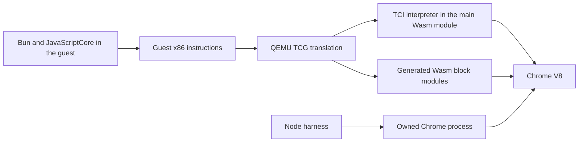

# defuss-qemu architecture

VERIFIED: This repository consolidates the QEMU source, retained Wasm
runtimes, guest packaging and browser test harnesses. Experimental source
overlays and builds live separately from the retained runtime. Source and
runtime manifests let the verification commands detect accidental changes.
The selected MSG1 build lives in `runtime/current/`; the RNDS2 runtime keeps its
original path and hashes. Selection changes the release default without erasing
the control needed by historical measurements.

## Package boundary

VERIFIED: The npm package includes the selected three-target binaries, their
browser dependencies, PC firmware, license notices and a source archive.
Guest disks, operating-system images, snapshots and captures are excluded.
`packaging/npm/build.py` verifies each selected binary before staging `dist/`.
`packaging/npm/check.py` installs the tarball into a clean consumer and boots
the installed runtime from both the application's origin and a separate origin.

The loader selects MSG1 during `onRuntimeInitialized`, before QEMU starts.
The PC and Bun hosts also initialize native services at that boundary: calling
the CD staging function from `preRun` produced a stack error in the selected
build. A real CD staging check covers that defect in the package consumer.

Cross-origin ES-module workers start through a local Blob that imports the
runtime's absolute URL. This keeps Wasm dependencies relative to the runtime
while satisfying the browser's worker-origin rule. The application still needs
cross-origin isolation; the remote files need CORS access. The Node loader
preserves the generated runtime's worker handling.

## Measured execution path

The current application studies run an amd64 Bun guest inside the retained
x86-64 QEMU Wasm runtime in Chrome. Node orchestrates the browser. Bun uses
its pinned JavaScriptCore for guest JavaScript and native guest code for
operations such as hashing. QEMU interprets cold TCG blocks and admits hot
blocks as separate Wasm modules. Chrome's V8 executes the outer Wasm.

The [pinned engine investigation](research/engines/README.md) records the
versions and source mechanisms. The newer
[measured priorities](research/engines/new-opportunities-01.md) govern the
next investigation; the old plan remains historical context.

## Verification and evidence

The guest protocol stops execution at named boundaries. The host persists
serial output and observations before acknowledging continuation. Frozen
plans bind runtime, guest and driver identities; fresh captures use separate
directories. Failed and interrupted attempts remain available. This retains
the evidence needed to distinguish an implementation change from a change in
workload or measurement procedure.

CPU profiles and pressure-counter captures are separate from unprofiled
timing. The former retain per-target samples and phase records; the latter
use existing stopped counter reads. The current profiler calibration shows
that waiting Wasm stacks can be sampled, so the reports keep sample counts
separate from exclusive CPU cost and performance claims.

The installed defuss-vae CLI and hooks are pinned under `.agents/` by
`.vae/installation.json`. This chat invokes the installed gate with its actual
session identifier. `make verify` covers installation integrity, real VAE
integration tests, an installed npm artifact booted in Chrome, and retained
source/runtime checks. The gate also verifies the diagnostic and
timing evidence bindings. Coverage is scoped to the installation verifier;
it is not whole-VM coverage. See the
[onboarding record](docs/decisions/vae-onboarding-01.md) for the hook-activation
and coverage boundaries.

## Operations

The repository retains its Node, Python and pinned Emscripten SDK toolchain.
Builds and captures run serially. Long captures use VAE's detached process
registry with owned logs and exit receipts. Each browser uses a scratch
directory below `tmp/`; cleanup checks identify only processes belonging to
that directory. Controllers preserve a failed attempt and stop instead of
silently replacing it.

The current cold timing protocol uses one guest vCPU, 512 MiB guest RAM,
2 GiB outer linear memory, a 12,000-instance limit and a thirty-minute capture
deadline. These are study settings, not resource measurements for every
supported guest. `DEFUSS_VM_CHROME` selects the executable for these drivers;
the controller validates the expected path. The example environment file
documents it without creating a local override.

Local checkpoints copy and verify source and selected evidence; separate
runtime archives preserve the exact binaries. They do not claim an
off-machine backup. Each checkpoint includes the retained handoff record.

## Security and privacy

The study's HTTP server listens on loopback and serves a hash-bound allowlist
of runtime, driver and guest assets. Cross-origin isolation headers enable
the shared-memory Wasm runtime. The guest and host communicate through the
bounded serial/QMP protocol; rejected records remain in the evidence.

The guest acceptance server mounts the installed package and explicitly named
local media. Its default responses retain same-origin resource policy; a test
server can enable CORS to exercise CDN loading. Guest media is read through
browser file inputs or the explicit test mounts and is not part of npm output.

Reports contain local paths, process identifiers, guest maps and serial data.
Captures, logs and checkpoints remain in this workspace. These experiments
do not configure an external research endpoint or upload the captured data.
