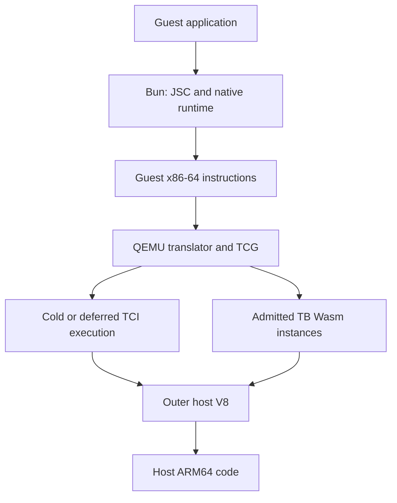

# Performance research handoff, 2026-11-10

## Objective and selected release

Continue performance research from the user-selected MSG1 architecture. Find
an application-level improvement over the original RNDS2 reference while
preserving guest correctness, service responsiveness and resource limits.
The user explicitly chose the newest candidate despite the absence of a
confirmed speed gain. Keep that selection; performance promotion is a separate
decision. `PLAN.md` and `AGENT_HANDOFF.md` contain historical context, not the
default sequence for further optimization.

VERIFIED: Implementation commit `d017661` consolidates the MSG1 candidate,
the `defuss-qemu` package and guest acceptance. The session gate passed
verification, contextual review and documentation at fingerprint
`2c54c4b2dcbe95c4c539e7ff2b706d52f1cfcdafb5b4ff89fd0012554c6879d3`.
Evidence: `tmp/consolidation-20261110/final-gate.log` and
`manifests/release-acceptance.json`. The commit is local; this consolidation
has not been pushed or published to npm.

VERIFIED: `manifests/consolidation-candidate.json` selects the exact three
MSG1 source files from `m2-msg1-performance-build-01`. The clean three-target
build is `artifacts/consolidation-build-01/build-report.json`; selected
binaries are in `runtime/current/`, identified by
`manifests/runtime-selected.json`. M3b fusion, memory32, scalar-lane rewrites
and MSG2 are not combined into this release.

| x86-64 reference | Wasm bytes | SHA-256 |
| --- | ---: | --- |
| Selected MSG1 | 13,367,929 | `7a6deedb63a340b57389570c7b978e078591615b10376b8a3ad1ad91fe78ee36` |
| Original RNDS2 | 13,232,981 | `ecfbc2b4efa6cffaf2b1a22e2d511f6a1e429c6f70c98aafe665176712c8bad4` |

VERIFIED: Original RNDS2 remains at `runtime/x86_64/`, bound by
`manifests/runtime-baseline.json`. The selected Wasm is 1.0198% larger than
that reference. The older MSG1 study's 0.1702% growth describes a different
build; its size result does not transfer to this one. A future promotion
claim under the historical 1% growth budget must address this difference.
Matching source does not establish matching generated bytes or timing.

## Functional acceptance and preservation

VERIFIED: The accepted installed package is
`tmp/npm-consumer-p5MV3E/node_modules/defuss-qemu`. Its runtime and production
module identities match the selected release. The receipt requires these
actual results:

| Scope | Evidence | What passed |
| --- | --- | --- |
| MSG1 ISA | `artifacts/consolidation-final-01-isa-{off,on}-{cold,hot}/report.json` | MSG1 OFF/ON with cold/hot thresholds, exact arithmetic and fault behavior, late configuration rejection |
| Bun in Node | `artifacts/consolidation-final-01-bun/report.json` | Cold start, separate-process restore, identical nonce, file and HTTP operations |
| Bun in Chrome | `artifacts/e2e/consolidation-guests-02-bun-browser/report.json` | Separate-origin package, Chrome restart, IndexedDB restore and unchanged application state |
| Windows 98 | `artifacts/e2e/consolidation-guests-02-win98/` | Desktop and three untraced plus three traced Notepad cycles |
| FreeDOS / BusyBox | `artifacts/e2e/consolidation-final-01-{freedos,busybox}/guest.json` | Real guest command/file operations, unchanged source media |
| SliTaz | `artifacts/e2e/consolidation-slitaz-03-slitaz/guest.json` | Supplied ISO desktop, root shell, unique-token FAT file write and readback |

VERIFIED: SliTaz desktop readiness took 673.102 seconds in this acceptance
run. Bun's cold/restored times and this SliTaz time are diagnostics, not paired
RNDS2 comparisons. The Windows report's `baseline` field means untraced runs
of the same MSG1 candidate, not original RNDS2. Fresh i386/ARM64 builds passed;
these x86-64 guest checks do not establish full guest acceptance on those targets.

VERIFIED: The final package consumer check used
`output/npm/20261110-055019-8d904c/defuss-qemu-0.1.0.tgz` and passed real
same-origin and separate-origin browser loading. It is 52,164,152 bytes packed
and 89,460,714 bytes unpacked, with all three runtimes and corresponding
source. Guest media and snapshots are excluded. See `packaging/npm/README.md`
for the API, isolation/CORS requirements and publication template; jsDelivr
publication itself has not been tested because the package is unpublished.

VERIFIED: The durable local checkpoint is
`checkpoints/20261110T055423.802649Z-e6735e9bf4bd-consolidation-msg1-release-01/`.
Its source/evidence archives passed readback verification for 17,065 files.
`output/recovery/consolidation-msg1-01/accepted-inputs.zip` additionally saves
the exact accepted consumer, Bun bundle, fixtures, screenshots and session
attestations with project-relative paths and a hash manifest. These are local
recovery copies. The external private Windows disk is outside that archive.
`tmp/consolidation-20261110/work.json` and `preservation-result.json` record
completion. This handoff postdates that checkpoint.

## Read the evidence before choosing another optimization

Start with `research/engines/new-opportunities-01.md`, then
`research/engines/README.md` for the version-pinned engine investigation.
The latter includes chronological experiment proposals; later result pages
and this handoff determine their status.

VERIFIED: The source references are retained under
`artifacts/engine-reference-01/source/`. `research/engines/checkouts-01.json`
and `additional-source-files-*.json` record commits and inspected hashes.

| Reference | Recorded identity |
| --- | --- |
| `v8-chrome` | Chrome 157.0.8103.38 / V8 15.7.112.23; commit `440c1c463e2e528c309af5067952e7b11631507f` |
| `node` | Node 26.11.1 / V8 14.6.202.34-node.37; commit `364593d0631def13e3043dd84f77ebca2c767ce5` |
| `bun` | Guest Bun 1.4.4; commit `38afee6c84fcf48c0edb2466aa4b27d287a59c30` |
| `webkit-bun` | Bun's pinned JSC/WebKit; commit `d6375c72affe0f70222cdcb45012b10f0bf3a9d5` |

Observe engine identities again before another campaign. A browser update
requires its own source references and versioned results.



VERIFIED: Node orchestrating Chrome does not make Node's V8 the VM execution
engine. Guest Bun uses JSC; its Wasm tiers do not compile the outer VM.
Integer recurrence, JSC native JSON, Bun native crypto and HTTP/kernel paths
have different execution mechanisms. Use the actual workload path.

VERIFIED: The checked-out V8 sources distinguish our TB-entry threshold from
V8's executed-byte tiering budget. Admitted does not imply optimized. Native
Wasm imports can remain Wasm-to-Wasm, while cross-instance boundaries inhibit
inlining. Module construction timers omit possible first-entry and background
compilation work. Node forced-tier disassembly is not Chrome default-tier
evidence. Guest JSC publication also makes a virtual PC insufficient as code
identity. Read the cited source locations in the engine report before relying
on any of these mechanisms.

## First research question: admission policy and retained instances

VERIFIED: The RNDS2 CPU capture had 9,651 of 12,000 slots charged at readiness
and 11,547 at its last workload. `inc_counter` in `engine/qemu/tcg/wasm64.c`
raises the admission requirement to 6,000, 24,000 and 96,000 entries at 80%,
90% and 95% occupancy when the hot limit is 1,500. Detached instances remain
charged until their finalization callback. A count below the hard cap does
not rule out admission deferral.

VERIFIED: The separate RNDS2 pressure capture counted 5,565,925
admission-held interpreted intervals and zero hard-cap fallbacks. JSON and
HTTP contributed 2,039,954 and 2,591,863 intervals across their three measured
batches. These are exposure counts, not elapsed-cost shares. Evidence:
`artifacts/engine-pressure-exposure-01/analysis.json` and
`experiments/engine-pressure-exposure/README.md`.

HYPOTHESIS: Earlier admissions leave useful application blocks interpreted;
a better allocation policy could reduce application time. First reproduce
the relevant exposure on the selected MSG1 binary in a separate diagnostic.
The retained RNDS2 drivers bind RNDS2 inputs: derive a fresh driver and record
its inputs rather than overwriting their capture or substituting hashes.

Proposed causal test: on the same selected MSG1 binary, compare runtime flags
3 versus 2 before vCPU startup. Bit 0 controls pressure admission; bit 1 keeps
REP batching enabled. Keep MSG1 enabled, the 1,500 threshold, 12,000 cap and
guest workload fixed. The meter bit, giving flags 7 or 6, belongs only in
separate diagnostic runs. Include original RNDS2 as a reference if claiming
an improvement above RNDS2; a policy ON/OFF result alone cannot prove that.

Reject the hypothesis if less interpretation merely increases compilation,
retained-instance pressure, memory, waiting or service latency without a
reproducible application benefit. Observe reuse and finalization before
designing eviction: the counts do not prove that charged modules are stale
or safely reclaimable. Lowering the nominal hot limit alone leaves the
pressure calculation's 1,500 floor in place. Do not raise the cap to force a pass.

## Second research question: interpreter and dispatch work

VERIFIED: In the RNDS2 guest execution worker, `defuss63_fast` accounted for
10.0%, 24.0%, 17.1% and 38.0% of observed leaf samples in integer, JSON, SHA
and HTTP respectively. `cpu_tb_exec` also appears prominently but contains
dispatch and inlined general TCI work. These are sampled stack observations,
not exclusive CPU fractions. Evidence:
`artifacts/engine-cpu-findings-01/report.json`.

HYPOTHESIS: Decoding and private register traffic in surviving TCI execution
offer broader gains than another isolated SHA lowering. Inspect
`defuss63_fast`, its `tcg_qemu_tb_exec_tci` caller and `tcg_qemu_tb_exec` in
`engine/qemu/tcg/wasm64.c`, then inspect the emitted Wasm and actual host code
for the observed path. The bounded leaf handles up to 64 scalar operations
and stops before guest access, helpers and control transfers.

First separate decoding, register materialization, general TCI and compiled
dispatch with a calibrated diagnostic boundary. Reuse existing counters where
their meaning fits; do not sum inclusive stack totals or infer exclusive time
from counts. Reject a local rewrite if an unchanged-application comparison
does not retain its component benefit. Preserve stop/interrupt, fallback,
fault, state and code-invalidation semantics.

## Third research question: vector loads through the guest MMU

VERIFIED: Sampled SHA stacks connect compiled blocks through `helper_ld_i128`
to `mmu_lookup` and `mmu_lookup1`. In that worker's SHA leaf samples, the load
helper accounted for 7.1% and the two MMU functions together accounted for
12.3%. The sixteen-byte load path in `engine/qemu/accel/tcg/cputlb.c` handles
page crossing, MMIO, watchpoints, endianness and atomicity.

HYPOTHESIS: A cheaper ordinary-RAM TLB-hit path or less repeated translation
could help. First observe the actual same-page RAM hit rate, required checks
and generated code. Preserve the exceptional paths and exact fault behavior.
Host bounds traps cannot replace guest MMU semantics. Reject this direction
if ordinary-path exposure or application benefit is too small to justify it.

## Lessons that should change the next experiment

VERIFIED: The following outcomes constrain further research; none supplies
an automatic next implementation. The table reports elapsed-time ratios
with each study's marginal 95% interval; smaller ratios are better. The linked
reports define the independent launch blocks and endpoint boundaries.

| Experiment | Result and implication | Record |
| --- | --- | --- |
| M3b cold exploratory comparison | Full horizon ON/original 1.1831, interval 1.0959 to 1.2772; fusion-disabled base also had cost. Do not assume fusion alone explains it or combine it by default. | `docs/decisions/m3b-idle-timing-01.md` |
| RNDS2 scalar-lane v2 confirmation | SHA/original 0.9904, interval 0.9102 to 1.0776. Smaller Wasm/native code did not establish application gain. | `research/engines/lane-v2-confirm-results-01.md` |
| Memory32 address profile | Horizon/matched rebuild 1.1233, interval 1.0483 to 1.2037; Wasm grew 4.53%. Node's smaller component code did not predict Chrome VM benefit. | `research/engines/memory32-results-01.md` |
| Unchanged-source rebuild confirmation | Horizon/original 1.0481, interval 0.9513 to 1.1548. The exploratory gain did not reproduce. | `research/engines/rebuild-confirm-results-01.md` |
| Loaded-host MSG1 study | SHA ON/original 0.8609, interval 0.6780 to 1.0931; six blocks, eighteen captures. Neither gain nor non-regression was established. | `research/engines/msg1-results-01.md` |

VERIFIED: A known 1.5-second `memory.atomic.wait32` produced 599 waiting-Wasm
samples out of 601 worker samples in
`artifacts/engine-cpu-wait-calibration-01/report.json`. Futex frames cannot be
called busy CPU time from these samples. Full exclusive attribution, actual
per-TB outer V8 tiers, guest JSC tiers and compiler-thread cost remain unknown.
Inspect tiering only in separate diagnostic runs; forced flags or profiler
activation must not silently enter the performance protocol.

Keep a prospectively fixed primary endpoint, independent launch blocks and
balanced arm orders. Nested workload batches are not independent launches.
Freeze exact runtime, guest, driver and dependency hashes. Use a matched
unchanged rebuild if a candidate requires rebuilding. Preserve every capture,
failure and interruption; do not extend a study until significance or pool
exploration with confirmation. Record host load without calling slower loaded
results deoptimization. The authorized per-capture deadline is 30 minutes.

Measure application time independently of diagnostic counters, plus compile
and instance behavior, peak process memory and service latency. Historical
2 GiB linear-memory and under-cap observations do not close those resource
gates. Add a held-out application and relevant platform checks before broad
performance claims. Keep historical snapshot-replay figures separate from
cold-launch measurements and package acceptance timings.

VERIFIED: Consolidation exposed two runtime integration defects: native CD
staging in `preRun` overflowed the Wasm stack, and direct remote module workers
failed the origin boundary. Native initialization belongs in
`onRuntimeInitialized`; `host/browser/runtime-loader.mjs` supplies the shared
Blob bootstrap. Real package tests cover both origins. FreeDOS required
physical key events; SliTaz required observed prompt readiness, followed by
an actual guest disk oracle. Boot pixels alone do not prove guest correctness.

VERIFIED: Historical captures retain four exact checkpoint-recovered metadata
and Bun-launcher files through
`experiments/engine-cpu-profile/evidence-inputs.mjs`; all other bindings still
verify live. Do not turn this narrow recovery mapping into a general waiver
for changed drivers. `.vae/checks/release.py` separately rejects stale release
inputs, with a retained real-file mutation check.

## Resume safely and leave an inspectable result

Read `AGENTS.md`, `.vae/MEMORY.md` and `.vae/CLI_GIST.md`. Use the installed
`.agents/scripts/vae.py`; do not edit its pinned payload. On resuming this
chat, preserve its baseline under `tmp/vae/2026-11-08_12_43_02_1/` and use the
existing `CODEX_SESSION_ID`. A distinct chat needs its own legitimate session
baseline. Automatic Codex hook attachment is unverified; invoke the gate.

These read-only commands check the retained release and research evidence:

```sh
git status --short
python3 -B .agents/scripts/vae.py swarm status --repo .
python3 -B .vae/checks/release.py
node experiments/engine-cpu-profile/check-evidence.mjs
```

Keep scratch under `defuss-vm/tmp`. Use fresh labels and detached VAE jobs
for builds, guest VMs and captures, and run them serially. Stop the SDK VM
and preview service before timing. Keep the selected release and original
RNDS2 intact while candidates live in separate artifact directories. Do not
delete failed attempts or overwrite frozen plans and analysis inputs.

The next agent should deliver a bounded diagnostic answering whether
admission-held interpretation persists on the selected MSG1 build, followed
by a prospectively specified causal comparison if exposure warrants it.
Record the mechanism, falsifier, exact inputs, raw evidence and decision.
If the result contradicts the hypothesis, stop that candidate and use the
observation to choose the next question. Passing correctness and a preferred
architecture remain separate from demonstrated performance improvement.
