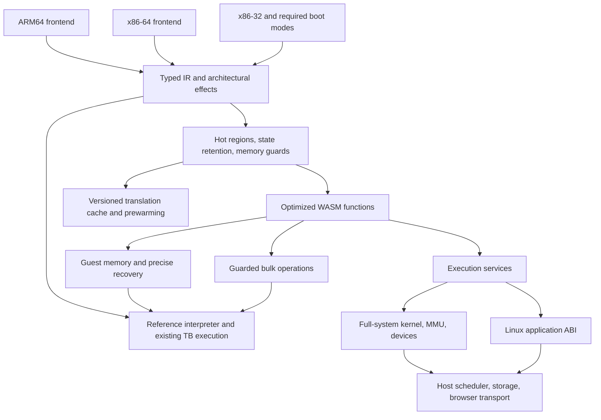

# defuss-vm: a WASM-first virtual machine

**Status:** implementation in progress. The validated QEMU baseline is
consolidated here; isolated SHA instruction lowerings and one-TB region
infrastructure now have real guest validation. A bounded two-block prototype
has passed native boundary fixtures; its broader coverage discrepancy is under
investigation. Full multi-TB acceptance and the Linux application profile remain
open. See [implementation status](docs/IMPLEMENTATION.md)
for completed checks, failed performance selections and remaining gates.
The existing browser pages and Win98 automation are now available under
[e2e/](e2e/README.md), with shared browser modules in `host/browser/`.
**Date:** 7 November 2026.
**Location:** `defuss-vm/` is the destination for new development.
**Starting point:** the existing QEMU-WASM implementation and its independently
verified Bun benchmarks in the parent workspace.

This plan records the complete proposed direction: retain proven guest CPU
semantics, replace expensive execution boundaries with a WASM-specific engine,
add guarded bulk operations, and investigate a Linux application profile that
can run supported Linux binaries without emulating a guest kernel. Full-system
virtual machines remain a supported profile.

The immediate objective is to explain and reduce the measured Bun performance
gap. smolvm supplies a useful product target. Direct WASM implementations of
individual operations supply optimistic computational references. Neither
establishes a promised speedup for the new VM.

All milestones below are future work unless explicitly marked **existing** or
**measured**. Creating this document does not change the current runtime,
bundler defaults, benchmark inputs, snapshots, or upstream checkout.

**Navigation:** [scope](#1-product-scope-and-decisions),
[baseline](#2-measured-starting-point),
[existing engine](#3-what-already-exists-and-what-remains-expensive),
[architecture](#5-target-architecture),
[correctness](#6-correctness-contracts-across-all-workstreams),
[profiling](#7-workstream-a-profiling-and-practical-wasm-references),
[regions](#8-workstream-b-bounded-regions-and-architectural-state-retention),
[memory](#9-workstream-c-memory-access-and-layout),
[semantic operations](#10-workstream-d-semantic-operations-simd-and-conversions),
[CPU profiles](#11-workstream-e-guest-cpu-feature-profiles),
[snapshots](#12-workstream-f-startup-com1-snapshots-and-translation-reuse),
[I/O](#13-workstream-g-scheduling-control-and-networking),
[Linux ABI](#14-workstream-h-linux-application-personality),
[measurement gates](#16-benchmark-and-promotion-policy),
[milestones](#17-milestones-and-dependencies),
[layout](#18-proposed-repository-layout-and-migration-strategy),
[risks](#19-risks-and-explicit-stop-criteria),
[sources](#20-source-map-and-retained-evidence).

## 1. Product scope and decisions

### 1.1 Required scope

| Area | Decision |
|---|---|
| Execution target | WebAssembly; optimize its generated code, memory model, browser integration, and host runtime directly. |
| Guest ISAs | ARM64, x86-64, and x86-32. Preserve the 16-bit execution needed by x86 full-system boot and legacy systems. |
| Initial optimization target | Linux amd64 with the pinned official Bun distroless image and the existing TypeScript workload. |
| Application packaging | Linux only initially; Bun distroless; amd64 by default; reusable TypeScript bundling script. |
| Snapshot default | Attach COM1; an application-ready signal requests one reusable snapshot for the application and compatible runtime. |
| Full-system profile | Guest kernel, MMU, interrupts, devices, and existing Windows 98 compatibility. |
| Linux application profile | Separate experimental profile sharing the CPU translator, with a supported Linux userspace ABI implemented by the host runtime. |
| Acceleration | Exact instruction lowering first; guarded regions and bulk operations next; explicit cooperative runtime interfaces where necessary. |
| Compatibility strategy | Preserve an executable reference/fallback and add accelerators incrementally. |
| Evidence | Host-clock measurements, arbitrary-input correctness tests, immutable artifacts, and independent confirmation. |

The earlier architecture comparison supports keeping amd64 as the present Bun
default. It does not establish that amd64 must remain fastest after a new
backend is built. Reassess ARM64 after common optimizations are available;
do not silently change the default during an experiment.

x86-32 support is an engine requirement, not a claim that the current Bun image
exists for that target. Guest ISA support and application-image availability
must have separate compatibility tables.

Expose three explicit machine/application profiles: PC compatibility, Linux
full system, and Linux application ABI. The first two share the full-system
core but may select different devices. An ISA frontend does not implicitly
choose a device model, operating-system personality, or WASM memory width.

### 1.2 Boundaries of the work

- Preserve the official pinned Bun image for the primary transparent-VM track.
  A modified Bun/JSC build is a separately named, versioned, opt-in profile.
- Do not rewrite all CPU decoders, operating-system behavior, and devices at
  once. Reuse QEMU semantics while replacing measured costs.
- Do not infer runtime cost from source-code size or portability abstractions.
  Many QEMU decisions happen during translation or disappear at compile time.
- Do not recognize benchmark inputs, return cached answers, or replace the
  workload with an easier operation. Optimizations must work on arbitrary
  inputs within their documented contract.
- Keep the full-system and Linux application results separate. Removing a
  guest kernel changes the execution model and must be reported explicitly.
- Preserve prior sources, packages, measurements, and failed experiments.
  New experiments receive fresh directories and labels.

## 2. Measured starting point

The completed [smolvm comparison](../native-build/bun-smol-compare/results/confirm01/REPORT.md)
used the same bundle and original operations on both systems:

- Apple M5 Max, 18 logical CPUs, 48 GiB RAM, macOS 26.7.1.
- Native: ARM64 Linux under smolvm 1.32.4 / Hypervisor.framework.
- WASM: amd64 Linux under the optimized RNDS2 QEMU-WASM runtime in Chrome
  157.0.8103.38.
- Bun 1.4.4, revision `38afee6c84fcf48c0edb2466aa4b27d287a59c30`;
  one vCPU and 512 MiB guest RAM on both.

| Endpoint | smolvm/native median | QEMU-WASM median | Paired geometric WASM/native ratio | Approx. 99.1667% interval |
|---|---:|---:|---:|---:|
| Cold app readiness | 454.574 ms | 24,378.142 ms | 47.87× | 31.66–57.15× |
| Available launch: native cold / WASM restore | 454.574 ms | 2,001.507 ms | 4.09× | 2.60–5.19× |
| Integer, 100 calls | 42.684 ms | 412.893 ms | 12.08× | 9.44–22.34× |
| JSON, 100 calls | 13.039 ms | 2,596.640 ms | 199.55× | 193.86–208.55× |
| SHA256, 100 calls | 33.139 ms | 2,260.208 ms | 68.80× | 66.02–72.21× |
| Guest-loopback HTTP, 100 calls | 12.729 ms | 4,059.900 ms | 316.22× | 297.17–339.26× |

These ratios are geometric means of paired ratios, not ratios of the displayed
medians. They compare the available complete systems, including different
guest ISAs and hardware-assisted versus software-translated execution.

### 2.1 What the measurements establish

Eight alternating pairs produced 24 serialized observations: eight native
cold boots, eight WASM captures, and eight fresh-browser restores. All 192
measured batches, 19,200 measured calls, and 1,104 acknowledged protocol events
passed. Native was faster in all eight pairs at all six endpoints.

The independent review reproduced the statistics, passed 17,719 checks, and
rehashed 134 file identities. The retained [analysis](../native-build/bun-smol-compare/results/confirm01/campaign.analysis.json)
and [independent review](../native-build/bun-smol-compare/results/confirm01/independent-review.json)
are the evidence, rather than rounded numbers copied into this plan.

### 2.2 Measurement limits to preserve

- Startup excludes browser/controller/daemon process launch, builds, downloads,
  and image imports. Local image and filesystem caches were retained.
- Native cold runs rebooted the same provisioned machine/disk with fresh Bun
  processes. No native snapshot-resume result exists: pause rejected the
  deployed host-backed image layers.
- WASM restore ended after the guest validated retained state and continuation,
  not merely after the host reported migration completion.
- Execution used ten fixed warmup cycles and three ordered batches of 100
  calls. Fixed warmup does not prove either guest or host JIT convergence.
- Host monotonic clocks are authoritative. Guest clocks substantially
  understated elapsed WASM execution in earlier work.
- Control transport remains included. Empty-gate medians were 0.179 ms native
  and 10.381 ms WASM. That WASM gate is a batch boundary, not a charge applied
  to each of the 800 HTTP requests in a 100-call HTTP batch.
- All observations, including the slow first WASM integer observation and the
  slow second native cold start, remain included. Their causes are unresolved.
- Host background work was left running. These are measurements under the
  recorded conditions, not universal hardware constants.
- Durable WASM capture added a median 6.083 s after initialized readiness;
  snapshot files had a median size of 91.5 MiB. Capture cost is separate.

### 2.3 Frozen identities

| Artifact | Identity |
|---|---|
| defuss-container checkout | `4818652554be577d5fa3231248a574eb5bfb16fa` |
| Comparison bundle SHA256 | `8da011224d282638f14effc56450e70bddc4459a904c4b4a0c317168ff44cdc9` |
| RNDS2 runtime WASM SHA256 | `ecfbc2b4efa6cffaf2b1a22e2d511f6a1e429c6f70c98aafe665176712c8bad4` |
| RNDS2 runtime JS SHA256 | `2593a7d8d08971578bc68cab6d032408093d3d4bde0353bc085fcaf96c1adb9c` |
| Official amd64 Bun image digest | `sha256:b14d4eb5d84af31d532380ad42fbc8243936bbe23e2b85c5f740efbd845fe6f2` |
| Official ARM64 Bun image digest | `sha256:f6e8216146f6cbe9fecaa7a8161876cafee774ef68013e975c7d63183004b934` |

Use the full frozen manifest for reproduction. This abbreviated table is not
a replacement for hashes of the kernel, initramfs, ROMs, compiler, scripts,
configuration, and all other inputs.

## 3. What already exists and what remains expensive

### 3.1 Existing capabilities to carry forward

| Existing behavior | Consequence for the new work |
|---|---|
| Strict WASM SIMD | Enabling SIMD again is not a new optimization. Find missing or inefficient lowering. |
| TCG registers in WASM locals | Target architectural-state traffic and boundary materialization, not a fictitious all-memory register implementation. |
| Lazy x86 condition flags | Extend their continuity and eliminate proven dead work; do not add an independent flag model. |
| Same-TB loops stay inside generated WASM | Focus on actual cross-TB edges and residual work inside loops. |
| Compiled-TB hits precede admission logic | Lowering hotness or bypassing admission cannot explain all steady-state performance. |
| Inline scalar soft-MMU primary-TLB fast paths | Improve successful access overhead and missing widths while preserving the existing checks. |
| Pthreads and `PROXY_TO_PTHREAD` | Moving execution to a worker is already done. Measure scheduling and host integration. |
| Native unwind-check helper | Preserve its semantics; identify remaining suspension cost separately. |
| Shared external RX ring | Improve notifications, batching, and ownership rather than proposing a ring as absent. |
| Translation plans and restricted AOT recipes | Integrate and evaluate existing machinery before designing a persistent translation cache from nothing. |
| COM1 snapshots and SHA256 compatibility identity | Preserve and extend the packaging and persistence contract. |
| Direct PSHUFB and SHA256RNDS2 lowering | Use the confirmed runtime as the primary starting control. |

The direct RNDS2 change independently reduced SHA replay time by 13.84% against
its measured PSHUFB control, with an approximate 99% interval of 10.40–17.28%
lower time. This is a result for that replay protocol. It cannot be multiplied
by earlier estimates or applied to all Bun work.

The early-helper-operand setup candidate has a promising JSON screen but no
independent performance confirmation. PMAXUB is also screened only. The
historical 128-bit load experiment is separate from the RNDS2 runtime. See
[incremental results](../native-build/bun-inline/RESULTS.md) and
[remaining experiments](../native-build/bun-inline/NEXT.md).

### 3.2 Source-backed residual boundaries

1. **Cross-block dispatch.** A generated cross-TB transfer generally writes
   `ctx.tb_ptr`, returns to the C-compiled WASM dispatcher, looks up the next
   compiled function, and makes an indirect WASM call. It is not a JavaScript
   crossing on every TB. Promotion does use JavaScript to construct a
   `WebAssembly.Module` and `WebAssembly.Instance`.
2. **State and helper setup.** Architectural values and generic helper
   arguments still move through memory at boundaries. The shared register
   spill bank used for unwinding is not an unconditional spill at every call.
3. **Successful memory access.** Scalar loads already have guarded direct
   RAM access. The emitter nevertheless adds `BLOCK_IDX`/resumption structure
   before the slow-path test. Inspect browser-optimized code before assuming
   all emitted bookkeeping survives optimization.
4. **Instruction-sized semantic work.** SHA still pays for instruction and
   helper boundaries that a whole compression operation could avoid. JSON
   traverses guest runtime allocation, scanning, conversion, and GC machinery.
5. **Operating-system execution.** The HTTP workload uses guest `127.0.0.1`.
   The Bun launcher has no NIC. Kernel execution and wake-ups are plausible
   costs; changing a virtual NIC does not directly fix this benchmark.
6. **Startup and restore copies.** Assets are fetched and hashed sequentially.
   Snapshot decode accumulates chunks, creates a complete raw buffer, hashes
   it, and copies it into Emscripten FS before migration reads it.
7. **Translation rebuilding.** A guest snapshot does not retain Chrome's
   compiled translations. Existing plan/AOT mechanisms are not enabled by the
   Bun launcher and are not a general compiled-WASM cache.

## 4. What is theoretically achievable with WASM

The target execution path should approach ordinary optimized WASM for a hot,
well-behaved computational region: native-width arithmetic, values in locals,
128-bit SIMD where semantics match, direct guarded RAM access, and few exits.
WASM supplies integer, floating-point, vector, memory, and structured control
instructions; guest instruction sequences need not remain one host helper
call per guest instruction. [WASM instruction specification](https://webassembly.github.io/spec/core/syntax/instructions.html).

There are still costs that a hardware virtual machine does not pay: translating
guest instructions, implementing guest architectural effects and address
translation, observing interrupts and code changes, and adapting host I/O.
An optimized WASM implementation of a kernel is therefore an optimistic
reference, not a demonstrated lower bound on every VM workload or proof of
native parity. Browser engines and hardware also optimize different operations
differently.

Use measured fractions to decide where a rewrite is justified. If a fraction
`f` of total elapsed time is accelerated by `s`, the idealized total speedup is:

```text
speedup = 1 / ((1 - f) + f / s)
```

For example, a tenfold improvement to 30% of execution gives only about 1.37×
overall improvement. Completely eliminating 90% gives at most 10×. These are
arithmetic illustrations, not measured fractions of this VM.

A large gap can justify larger architectural experiments, but the measured
JSON and HTTP ratios do not reveal which component owns that gap. First
attribute it. Then distinguish three opportunities:

- **Translation quality:** generate less and better WASM for unchanged guest
  behavior.
- **Semantic granularity:** replace proven equivalent work with one generic
  operation rather than many translated instructions.
- **Execution profile:** remove guest-kernel/device work for a deliberately
  supported Linux application ABI.

## 5. Target architecture



### 5.1 Frontends and common IR

Begin with the selected QEMU decoders and TCG semantics. Define a typed region
layer over the existing IR before considering a replacement IR. Preserve the
relationship among guest PC, instruction boundaries, operand types, memory
effects, flags, exceptions, and translation context.

The common optimizer should understand integer widths, scalar/vector values,
pure operations, explicit reads/writes, helper effects, side exits, and state
recovery. Architecture-specific code supplies precise flag, register, memory
ordering, and exception rules. Optimization must not depend on an instruction
mnemonic being shared across architectures.

Separate build products may be generated for different guest frontends. A
single artifact containing every frontend is not a product requirement.

### 5.2 Execution tiers

1. **Reference/fallback:** existing interpreter and validated single-TB path.
2. **Fast single blocks:** current direct lowering plus measured helper and
   memory improvements.
3. **Bounded regions:** selected connected TBs, shared values, direct internal
   control flow, exact side exits, and bounded service points.
4. **Guarded bulk operations:** generic operations whose inputs, outputs,
   side effects, and failure behavior have an explicit contract.

Retain admission and memory accounting at every tier. The current 12,000
instance cap and normal admission remain the experimental control. A region
cache needs byte limits and dependency limits as well as entry counts;
combining many blocks into one instance must not evade resource accounting.

### 5.3 Proposed internal contracts

These are design records, not existing APIs:

```text
TranslationIdentity:
  frontend, ISA features, privilege/mode, address-space context,
  guest PC, code-page identities/generations, runtime/IR ABI version

Region:
  entries, bounded CFG, typed values, effect summaries,
  code dependencies, guest-instruction map, service points,
  recovery maps, emitted module, resource accounting

RegionExit:
  reason, exact guest PC, recovery-map ID,
  committed-effect position, exception/interrupt/service payload

BulkOperation:
  operation/version, input/output layout, memory ranges,
  alias rules, fault/partial-progress rules, guard conditions,
  cancellation/service budget, fallback entry
```

An effect summary must distinguish a pure calculation from a helper that
writes through pointers, touches architectural state, can fault, can suspend,
or can trigger invalidation. A helper that does not read/write TCG globals is
not necessarily side-effect-free and must not be deleted as if it were.

## 6. Correctness contracts across all workstreams

### 6.1 Architectural state and exits

- Recover the precise guest PC, registers, flags, vector lanes, and required
  memory effects at faults, interrupts, helper calls, and region exits.
- Preserve x86 partial-register semantics, zero extension, VEX upper-lane
  behavior, lazy flags, segment/mode dependencies, and required legacy modes.
- Preserve ARM64 register-width behavior, condition flags, exclusive accesses,
  alignment, and architectural exception behavior.
- Materialize only state that an observer can see, but define that observer
  set explicitly. Unknown helpers force a conservative boundary.
- A guard failure may enter the original path before side effects or at a
  precisely recorded partial-progress point. It must not replay already
  committed stores, syscalls, or external operations.
- Long regions and bulk operations must honor instruction/service budgets,
  pending interrupts, cancellation, and browser responsiveness. Preserve
  architectural interrupt-recognition rules when choosing service points.

### 6.2 Memory and code identity

- Guest virtual addresses are not host linear-memory offsets. Preserve address
  translation, permissions, MMIO, watchpoints, page boundaries, endian rules,
  dirty tracking, and self-modifying-code invalidation.
- Do not use a host WASM out-of-bounds trap as a substitute for a precise guest
  page fault unless an explicitly verified recovery mechanism supports it.
- Preserve ISA-specific atomicity and ordering. A `v128` memory access is not
  automatically an atomic guest 16-byte operation.
- Invalidate region entries and accelerator matches when any contributing
  code page changes. Track address-space/context changes separately from raw
  code-byte equality.
- Reclaimed translations must not remain reachable through stale function
  table entries or direct links. Retire them only after executing users are
  known to have left them and suspended continuations no longer reference
  them. Never recycle a slot still needed for unwind/resume.
- Entry invalidation alone is insufficient for a region already executing.
  If a store modifies later code in that region, exit precisely before stale
  instructions execute, preserving the modifying store exactly once.
- Bun/JSC-generated code and `mprotect` transitions are first-class cases.
  ASLR addresses alone are never sufficient accelerator identity.

QEMU's existing translation-context, chaining, and invalidation machinery is
a useful starting point; new region dependencies must extend those guarantees.
[QEMU translator documentation](https://www.qemu.org/docs/master/devel/tcg.html).

### 6.3 Numerical behavior

Preserve integer wraparound, signedness, shift rules, division corner cases,
floating-point rounding and exceptions, signed zero, and architecturally
observable NaN behavior. Guest-to-WASM conversion instructions are not always
equivalent: trapping, saturating, truncating, and guest invalid-result behavior
must be distinguished. Use exact guards and fallbacks where the host operation
does not implement the guest instruction directly.

Strict SIMD remains the default. Relaxed SIMD or host-specific numerical
shortcuts require a separately proven semantic contract, not a global switch.

## 7. Workstream A: profiling and practical WASM references

### 7.1 Questions to answer first

For cold boot, initialized capture, restore, and each workload phase, determine:

1. How much wall time belongs to interpretation, compiled guest execution,
   translation/compilation, helper work, scheduling/waiting, and host I/O?
2. Which guest PCs and edges account for the execution, and are they Bun/JSC,
   generated JavaScript code, libc/runtime code, or kernel code?
3. How many executed memory accesses are clean TLB hits, misses, special
   mappings, alignment/page crossings, or widths lacking a direct path?
4. Which SIMD/AVX/SHA/conversion families execute, and through which lowering?
5. Which code is repeatedly translated or invalidated? Does the guest or host
   JIT continue changing during the measurement interval?
6. For HTTP, which syscalls, kernel paths, waits, and wake-ups dominate?

### 7.2 Diagnostic implementation

Extend existing counters before creating overlapping instrumentation. Use
phase-gated snapshots of counters, host-side sampling, and bounded per-PC/edge
tables. Keep diagnostic builds distinct from performance builds.

Collect:

- Interpreted and compiled execution counts, transitions, exits by reason,
  admission attempts/rejections, stale-entry misses, pool occupancy and bytes.
- Translation stages, module creation, instantiation, code size, and repeated
  compilation. Distinguish application compilation from host engine tiering.
- Guest user/kernel execution and mapped PC categories. Record provenance of
  symbol maps and code bytes; mark unidentified/JIT ranges as such.
- Helper families and exact path: reference helper, compiled helper, inline
  lowering, guarded fallback. Document subset counters to avoid double counts.
- Scalar/vector widths, alignment, clean read/write TLB hits, misses, special
  flags, page crossings, and dirty/invalidation work.
- Sampled CPU-state loads/stores and helper argument transfers; generated
  WASM size and optimized engine code where available.
- Wait/BQL/park/kick behavior, queued work, wake-up latency, event batches,
  and syscall families for the HTTP investigation.
- Snapshot fetch, verification, decode, copy, migration, ACK, and guest
  continuation times; peak memory and bytes copied where observable.

Timers must use exclusive categories or clearly documented nesting. Counters
are exposure evidence, not time attribution. Measure diagnostic perturbation
with a disabled-instrumentation control. Do not sum sampled time, nested helper
time, and enclosing execution time as independent costs.

### 7.3 Required instruction census

Produce an execution-weighted table, separately for each workload and phase:

```text
instruction/helper family | guest width | reference count | compiled count
inline count | fallback reason | sampled time | guest PC coverage
```

Prioritize SSE/AVX/NEON lane operations, loads/stores, byte comparisons/masks,
shuffles, integer arithmetic, SHA rounds/schedules, and numeric conversions.
Static instruction counts alone are not an optimization priority list. An old
census finding no YMM exposure is not a claim about every new workload.

### 7.4 Direct WASM reference suite

Build standalone kernels with the same input sizes, arbitrary-input fixtures,
and equivalent output checks for:

- The dependent integer recurrence using exact `i32` operations.
- SHA256 compression and complete synchronous hashing, timed separately.
- Byte scanning, escaping, number conversion, copying, search, and comparison.
- Shared-memory queue operations and local request/response primitives.

Measure direct kernel time, then kernel plus the proposed guard/bridge/copy
boundary, then accelerated guest time, then unchanged guest time. Record code
size, compilation cost, warmup, and engine version. Keep dead-code elimination
from discarding results without timing expensive validation inside the kernel.

For JSON and HTTP, a standalone parser or in-memory exchange is a component
reference, not a semantically equivalent replacement for Bun object creation
or a complete HTTP server. Host `JSON.parse` can be a diagnostic comparator,
but its allocations and runtime are different.

**Deliverable:** an attribution report with uncertainty, per-phase profiles,
PC/edge evidence, and a ranked hypothesis list. It must state what is still
unexplained and which experiments can plausibly affect each endpoint.

## 8. Workstream B: bounded regions and architectural-state retention

### 8.1 Start with the actual integer loop

The workload performs 250,000 dependent iterations of XOR, `Math.imul`,
addition, and unsigned coercion per call. Find its guest JIT code and measured
control-flow shape first. Do not attribute the earlier integer outlier to a
particular JSC tier without evidence.

The natural scalar form is an `i32` loop. Consecutive iterations depend on
previous results, so ordinary lane vectorization is not automatically valid.
Use arbitrary seeds, constants, and iteration counts in additional fixtures;
the transparent VM must execute the original bundled workload unchanged.

### 8.2 Region rollout

1. Represent one existing TB as a region with the same entry/exit semantics.
   Validate recovery, invalidation, accounting, and fallback before fusing.
2. Select a hot two-block unconditional edge with compatible translation
   context and no unknown helper or exceptional boundary.
3. Emit a single bounded WASM function containing both blocks. Preserve
   guest-instruction mapping, interrupt/service checks, and explicit exits.
4. Retain values across the internal edge; remove only proven redundant
   architectural-state stores/loads and flag computations.
5. Extend to a small loop or diamond only after two-block correctness and
   performance are independently established.
6. Expand region selection using measured hot edges and a fixed code-size,
   compilation, dependency, and service-budget policy.

Prefer structured loops and local branches within a region. Do not create an
unbounded recursive WASM call chain. Tail calls are an optional mechanism to
evaluate, not a substitute for region formation or a guaranteed speedup.

### 8.3 State and helper optimizations

- Track architectural values separately from temporary TCG locals. Preserve
  useful values across internal edges and materialize at defined observers.
- Extend exact helper operand forwarding independently from region fusion.
  Preserve signatures, ABI slots, liveness, aliases, clobbers, and return width.
- Make pure vector/scalar operations visible to the region optimizer. Keep
  vector lanes in locals across exact neighboring operations when safe.
- Reuse lazy-flag representations while retaining correct flags on every exit.
- Measure emitted versus surviving state traffic in optimized engine code;
  source-level removal alone is not a performance result.

### 8.4 Region acceptance

Differentially execute reference and region paths from the same initial
register/memory state. Compare full required architectural state and effects,
not only the workload checksum. Include untaken/taken exits, aliases, faults,
code changes, interrupts, helper exceptions, stale links, and cache eviction.
Include changes to the current block and a later block of an active region,
including writes through virtual aliases, and suspended-resume invalidation.

A two-block integer region must demonstrate real guest exposure, fewer
cross-block transitions or state transfers, and a reproducible improvement in
an uninstrumented run. If the integer workload already stays in one TB, pick
another measured hot edge rather than inventing a dispatch bottleneck there.

## 9. Workstream C: memory access and layout

### 9.1 Remove work from clean scalar hits

Use the census to select a common successful-access case. Examine generated
WASM and host-optimized output. Prototype moving resumability bookkeeping
onto the slow path while preserving the exact state needed if a helper faults
or suspends. Keep this change independently selectable from region fusion.

Acceptance must cover fast/slow transitions, faults after prior effects,
unwind/resume, read/write distinctions, page crossing, MMIO, watchpoints,
atomicity, and code/dirty tracking. A lower emitted instruction count without
an elapsed-time gain is not sufficient for promotion.

### 9.2 Guarded 128-bit accesses

Revisit the historical clean, aligned, 16-byte primary-TLB load candidate with
the current runtime and actual access census. Distinguish guest memory from
private CPU-vector storage; a private `v128` load needs no guest MMU lookup.

For guest loads/stores, preserve address checks, page crossing, byte order,
alignment, atomicity, and fault ordering. A pair of scalar accesses cannot
become one unchecked `v128` access. Store fusion additionally requires precise
partial-effect rules, dirty tracking, and invalidation. Keep unsupported cases
on the original helper path.

### 9.3 Reuse a page translation within a bounded region

After region recovery works, guard the translation context and page once,
retain a valid RAM addend/base, and reuse it for eligible accesses. Begin with
ordinary non-atomic reads on one clean page under the current single-vCPU
configuration, with no intervening helper or operation that can change mappings.
Exclude atomic/exclusive accesses initially. Preserve guest page-table
accessed/dirty effects as well as emulator dirty tracking. Extend only with an
explicit invalidation model and a separate multicore synchronization design.

Guard permissions, address-space/MMU mode, relevant page identity/generation,
and every access range. Bail out before an ineligible access. Concurrent
mapping changes, device effects, watchpoints, and stores need stronger rules;
they are not implicitly covered by the first read-only prototype.

### 9.4 Evaluate memory32 as a separate ABI experiment

A 64-bit guest requires 64-bit virtual-address semantics, not necessarily a
64-bit WASM offset for every physical RAM access. With bounded physical RAM,
translation can produce a checked 32-bit offset while guest addresses remain
`i64`.

The present runtime uses memory64 and a shared 2 GiB initial configuration in
the comparison setup. A memory32 experiment requires a defined layout for RAM,
runtime state, stacks, tables, heap, imported pointers, and migration buffers;
the total addressable budget matters, not just guest RAM size. It cannot be
implemented by truncating existing pointers.

Compare otherwise equivalent builds, including compilation, execution, memory
limits, copies, and snapshot compatibility. Keep support for larger memories
as a distinct configuration. Do not assume a fixed memory64 penalty without
measurements.

## 10. Workstream D: semantic operations, SIMD, and conversions

### 10.1 Three distinct acceleration interfaces

| Interface | Recognition | Compatibility contract |
|---|---|---|
| Instruction/region lowering | Decoded ISA operations and typed dataflow | Exact guest architectural behavior; generally applicable; default track. |
| Binary-specific routine substitution | Exact executable/build identity, relocated bytes, entry ABI, context, and code-page generations | Versioned compatibility extension; reconstruct all required guest-visible effects; fallback on mismatch. |
| Cooperative runtime operation | Explicit negotiated Bun/runtime interface | Separate opt-in guest build; typed buffers/results, lifetime and exception contract. |

Labeling a code range “JSON” or “SHA” does not establish its semantics. Every
accelerator needs declared inputs, outputs, effects, guards, fault behavior,
service budget, identity, and a safe fallback point.

The first interface offers the broadest transparent benefit. The second can
preserve the official Bun binary but requires substantial ABI and code-identity
work. The third is often cleaner for whole algorithms, but changes the guest
runtime and must remain separately reported.

### 10.2 Integer and generic bit operations

Lower exact modular arithmetic, rotates, masks, shifts, compares, extensions,
and selection to ordinary WASM operations. Remove redundant widen/narrow
sequences only with signedness and overflow proofs. Preserve flags at exits
even where the benchmark itself does not read them.

Use the region experiment for the actual integer loop. Do not add a dedicated
recognizer for its fixed constants or final result. Validate additional integer
programs with different loops and control flow before promoting a general
optimization.

### 10.3 SIMD and helper granularity

Prioritize by executed exposure and attributed cost:

- Byte compare, mask extraction, minimum/maximum, shuffles, and aligned lane
  operations used by string and JSON routines.
- Packed integer additions, rotates, shifts, schedules, and SHA round work.
- Scalar/vector move sequences and CPU-vector-bank traffic around helpers.
- AVX/YMM operations only when a measured workload reaches them. Two `v128`
  halves may implement a wider guest vector, but cross-lane behavior and
  upper-lane rules require explicit lowering.

Keep a scalar/reference oracle. Validate emitted WASM, forced fallback,
aliasing, and untouched lanes/registers. Native helper tests alone do not prove
that the guest reaches the compiled lowering.

Reconfirm the existing setup/JSON lead independently if it remains a good
near-term candidate. Extending setup forwarding to RNDS2 must preserve its
captured implicit XMM0 words, liveness, aliases, ABI, and R0/R1 clobber behavior.
A combined setup+RNDS2 build is a new candidate with new evidence requirements.

### 10.4 Bulk SHA256: first whole-algorithm prototype

Use a generic compression boundary as the initial contract:

```text
sha256_compress(state[8], input_bytes, complete_block_count)
  input: arbitrary 32-bit chaining state and complete 64-byte blocks
  output: updated 8-word chaining state
  no implicit padding, message identity, or cached digest
```

A conceptual pointer-based interface is insufficient by itself. Define byte
order, buffer bounds, overlap rules, state update order, memory faults,
interrupt/service chunks, cancellation, and progress reporting. Keep guest
buffering/finalization outside the primitive initially.

Implement and measure in this order:

1. Standalone synchronous WASM compression with an independent oracle.
2. Compression plus the proposed guard/memory/interface boundary.
3. Adjacent SHA instruction regions retaining state in locals, where the
   transparent ISA contract is already known.
4. Integrated bulk acceleration only after a valid routine ABI or cooperative
   interface has been established.

The exact pinned Bun compression entry and ABI have not yet been identified.
Do not guess them from a symbol name or PC. Binary substitution must account
for relocation, code-byte validation, modified/JIT code, register/flag effects,
return behavior, aliasing, and interruption. Unknown builds use the ordinary
path.

The existing SHA256RNDS2 lowering remains the control. SHA256MSG2 is another
bounded instruction target: its last two output words depend on newly computed
first words, so a naïve independent four-lane expression is wrong.

Test random chaining states, zero/one/many blocks, arbitrary data, offsets,
page boundaries, overflow-safe lengths, supported aliases, and rejected aliases.
For complete hashing, additionally test lengths around 55/56/63/64/65 bytes,
multiple blocks, exhaustive update partitions for short inputs, deterministic
boundary/randomized partitions for long inputs, total-length handling, and
finalization.
Compare against both an independent implementation and the existing guest path.

`crypto.subtle.digest` is asynchronous. It cannot silently replace Bun's
synchronous `createHash().update().digest()` path. A later host-crypto adapter
requires explicit guest suspension/completion semantics and must be measured
with those costs. [Web Cryptography specification](https://www.w3.org/TR/webcrypto/).

Any asynchronous or cooperative boundary must pin or copy inputs and outputs
under an explicit ownership contract. Revalidate mappings after suspension;
cached guest-to-host pointers cannot survive remapping, GC, helper effects, or
memory growth without a proven lifetime invariant.

### 10.5 JSON: optimize primitives before replacing object semantics

The workload parses and stringifies 128 records for eight rounds per call.
Start with general primitives: structural-byte scanning, ASCII/UTF handling,
escape detection, string copying, comparison, and number parsing/formatting.

Host `JSON.parse` creates host objects, not guest JSC objects. Transparent
substitution must preserve guest allocation, object shapes, GC roots, write
barriers, string representations, and allocation/error behavior.

A cooperative parser may produce a token tape or spans for the guest allocator.
Specify input encoding, offset units, lifetimes, output capacity, error location,
ownership, and fallback. Measure scanning, tape creation, transfer, and object
materialization separately; their sum determines whether the interface helps.

Complete JSON semantics include binary64 conversion, negative zero, duplicate
keys, UTF-16/lone surrogates, property order, array holes, unsupported values,
revivers, replacers, getters, `toJSON`, and exceptions. A restricted primitive
may have an explicit narrow contract; transparent `JSON.parse`/`stringify`
cannot be restricted to the benchmark's schema. [ECMAScript JSON specification](https://tc39.es/ecma262/2025/multipage/structured-data.html#sec-json-object).

Use nested structures, varied key order, escaped strings, boundary numbers,
invalid inputs, and held-out documents. Keep arbitrary guest object construction
on the original runtime path until a complete integration is proven.

### 10.6 Numeric conversions

Separate three problems:

- Exact guest instruction conversions, including exception flags and rounding.
- Runtime number-to-string/string-to-number algorithms.
- Redundant conversions introduced by JIT lowering that a region can prove
  unnecessary.

For the first prototype, choose a proven exact subset such as finite integral
values in range or exactly representable integer-to-double values, with a guard
and original-helper fallback. Do not conflate WASM trapping/saturating conversion
with x86 indefinite-integer and sticky-status behavior.

Tests compare results, required exception/status flags, preserved bytes, and
rounding-mode behavior. Cover signed widths, NaNs, infinities, signed zero,
subnormals, range edges, inexact conversion, MXCSR-related behavior, and ARM64
equivalents when that frontend is enabled. Confirm exposure during the measured
application interval because conversion counts can change with warmup.

### 10.7 Other bulk primitives

After SHA, consider `memcpy`, `memmove`, `memset`, byte search/comparison,
UTF validation, and common scanning loops. Use generic contracts with precise
overlap, bounds, faults, and progress rules. WASM bulk-memory instructions may
help with proven ordinary RAM ranges; they do not automatically implement a
guest routine's fault or partial-write semantics.

Hold each primitive to a second application or held-out workload before calling
it a general VM improvement.

## 11. Workstream E: guest CPU feature profiles

Guest runtimes choose algorithms according to advertised ISA features. A path
that is fast on physical x86 hardware may be expensive when translated to WASM.
Measure the interaction rather than assuming “more features” is always better.

Create explicit profiles with the same required baseline architecture and
different optional features. Determine which path Bun/libc/JSC actually selects,
then compare total application time, code size, helpers, and compilation cost.

Rules:

- Never advertise an instruction or architectural state the VM cannot execute
  correctly. Keep feature dependencies and saved CPU state internally coherent.
- Do not disable a feature that the pinned binary requires. Probe compatibility
  before timing and retain original behavior on unsupported configurations.
- Pin CPUID/ARM feature configuration in package, translation, and snapshot
  identities. Snapshots cannot move across incompatible CPU profiles.
- Keep feature-profile experiments independent from new instruction lowering
  so the cause of a gain remains identifiable.
- Revisit ISA choice only with comparable workloads and per-ISA correctness.
  Results on the Apple ARM64 host do not determine all browser/host combinations.

## 12. Workstream F: startup, COM1 snapshots, and translation reuse

### 12.1 Preserve the existing default

The reusable [Bun bundler](packaging/bundle-bun.py) already packages Linux
amd64 with pinned Bun distroless and enables snapshots by default. Automatic
readiness occurs after top-level module initialization;
`--snapshot-ready manual` lets the app choose its stable point.

COM1's current ready signal is ASCII `1` (`0x31`), not the binary byte `0x01`.
The guest writes the marker and waits for host `C` after cold capture or `R`
after restore. The benchmark's later `K` protocol is distinct. Keep these
protocols separately versioned.

The current init configures the serial port and keeps a descriptor open to
avoid last-close flushing/racing subsequent input. The host schedules snapshot
work on QEMU's AioContext outside the serial callback. Preserve both behaviors.
Reserve COM1 for readiness until `C/R`, then expose its ordinary serial
interface. For ARM64, define the same logical readiness channel with an explicit
guest-device binding rather than assuming x86 UART addresses.

### 12.2 Explicit preparation and flush contract

Top-level import completion does not mean all background application work is
ready, and writing COM1 does not automatically flush arbitrary app buffers.
Add a documented readiness preparation contract:

1. Finish required initialization and await designated startup work.
2. Reach a quiescent point for participating application threads/tasks.
3. Flush relevant runtime/application output buffers and drain prior console
   and serial output bytes; flush guest filesystem data when the application's
   persistence contract requires it.
4. Quiesce or declare external resources such as sockets and host-backed files.
   Define what can be snapshotted, rebound, or must be rejected.
5. Synchronously emit the readiness marker once, then block continuation until
   host ACK.
6. Host captures consistent CPU, device, RAM, and supported resource state,
   validates it, publishes it atomically, and only then acknowledges capture.
7. On restore, rebind supported host resources and ACK only after successful
   restore. Distinguish host migration completion from application continuation.

Automatic bundling remains the default for compatible apps. Applications with
asynchronous initialization use a documented awaited preparation hook or manual
readiness. A future hook must have a specified failure/timeout behavior and
must not claim to flush resources it does not own.

Existing local capture drains block operations and rejects writable inserted
block media. Keep that restriction until a separately tested storage-snapshot
contract supports such media; flushing alone does not make them restorable.

### 12.3 Identity and durable publication

Preserve the existing key structure:

```text
application bundle SHA256 / runtime compatibility SHA256
```

Application hash equality alone is insufficient. Compatibility must cover all
execution-affecting inputs: guest image, kernel/initramfs/ROMs where applicable,
CPU/memory configuration, runtime JS/WASM, guest ISA, feature profile, snapshot
schema, readiness protocol, and new accelerator/ABI versions. Include packaged
resources and environment/configuration that define initialized app state.

The filesystem store already fsyncs the completed temporary file, publishes it
without replacing an existing record, and fsyncs the directory chain before
ACK. Browser IndexedDB uses transaction completion with a strict durability
request; document the actual storage guarantees separately from filesystem
fsync semantics. Preserve checksum/length validation and bounded decompression.

Repeated ready bytes must not create repeated captures. Races between writers
must converge on a complete compatible record. Corrupt/incompatible records
may fall back to a cold start, with an explicit diagnostic event.

Add crash/failure tests around each publication step, concurrent writers,
changed app/runtime/config hashes, truncated data, quota/storage failures,
ACK withholding, capture timeout, and restored continuation. Verify nonce,
heap data, file sentinel, and continuation ordinal where appropriate.

Snapshot reuse also needs a policy for time, randomness, instance identity,
and external sessions. Capturing initialized state can intentionally retain
values; multiple fresh app instances may need explicit reseeding/rebinding
before becoming externally ready. Do not duplicate live external sessions by
assuming guest RAM is the whole application state.

### 12.4 Reduce startup copies without weakening validation

First measure each asset and snapshot stage, peak memory, and copied bytes.
Then evaluate independently:

- Bounded parallel asset reads/verification, with measured peak memory.
- Reuse of validated immutable assets under an explicit storage identity.
- Streaming decompression and migration ingestion with bounded buffers.
- Incremental integrity verification using an implementation compatible with
  the streaming design; do not assume the existing whole-buffer digest is
  incremental.
- Fewer Emscripten FS copies and explicit buffer ownership/lifetimes.
- Alternative compression levels/formats only with a versioned record format
  and measured capture/restore/size tradeoffs.

If streaming feeds migration before full verification, keep the VM suspended
and prevent external effects until the complete stream is validated. On failure,
discard the partial VM. Alternatively verify into a staging store before
restore. Never run partially verified state for an apparent startup gain.

Keep the bounded upload fix: earlier whole-snapshot CDP telemetry exceeded
Node's string limit. Transport must preserve backpressure, ordering, final
length/hash checks, and atomic durable publication.

### 12.5 Translation prewarming and cache tiers

Evaluate the existing mechanisms first:

1. **Plan hints:** guest bytes, PC/context, and promotion hints; decode live
   memory and validate context rather than trusting saved host addresses.
2. **Restricted AOT recipes:** build-authorized TCI recipes with byte/context
   checks and relocation. Current recipes reject helper-call-bearing entries.
3. **Future generated-WASM cache:** only after defining module identity,
   import/table rebinding, relocation, code/context validation, and invalidation.

The first two mechanisms already exist in source but are unused by the Bun
launcher. They do not preserve browser machine code. Persisting a portable
WASM module is also different from guaranteeing a browser's optimized-code
cache survives or is portable across engine versions.

Bind plans/cache entries to runtime/IR/helper ABI, guest features, code pages,
translation context, and relevant host features. Restored guest code must
still pass normal validation, especially dynamically generated JSC code.
Unknown or invalid entries become cache misses, not execution failures.

Measure preparation, load, verification, compilation, first useful work,
steady execution, memory, and break-even launch count. A bundling-time snapshot
or precompile step moves cost to preparation; record that cost explicitly.

## 13. Workstream G: scheduling, control, and networking

### 13.1 Diagnose the current loopback workload

Each HTTP job makes eight sequential requests to a Bun server inside the same
guest. There is no virtual NIC in the current launcher. Separate:

- Bun/JSC request parsing, allocation, and application execution.
- Guest syscalls and kernel socket/loopback processing.
- Futex/epoll activity, scheduling, timers, and wake-ups.
- Interpreter/compiled transitions and host coroutine overhead.
- Batch control/console overhead.

The historical census recorded more `sysret` helper exposure and interpreter
time in HTTP than JSON, but it used an older diagnostic protocol. Those figures
are leads, not current time fractions or complete syscall counts. Re-profile.

### 13.2 Optional binary control and completion ring

Start with one guest execution worker, an I/O coordinator, and a bounded
compilation queue. Parallel guest execution is a separate milestone.

Design a bounded shared-memory command/completion ring for cooperating Linux
applications or the future application profile. Use explicit ownership,
sequence numbers plus a VM-instance/restore epoch, memory ordering,
backpressure, batching, cancellation, teardown, and snapshot barriers. Wake
execution when work arrives instead of repeatedly polling where the host
integration permits it.

Reject late completions from earlier VM epochs; sequence numbers may repeat
after restore. Test wraparound, full queues, races, cancellation, shutdown,
snapshot pauses, and stale completions without silently overwriting work.

Keep COM1 for readiness, compatibility, debugging, and existing guests. A ring
can reduce app control and supported host-I/O costs; it does not by itself
remove guest Linux loopback processing.

### 13.3 External Ethernet path

The existing external RX ring contains 64 slots of 2,048 bytes and is polled
every five guest-virtual milliseconds. TX currently invokes main-thread JS and
copies a packet with `HEAPU8.slice`.

Prototype event-driven RX notification, bounded TX/RX batches, and buffer
ownership that avoids unnecessary copies. Prefer virtio-net for supported Linux
full-system guests; retain required legacy adapters for Windows 98. Preserve
packet order, queue limits, drops, device interrupts, and lifecycle behavior.

Use a separate external-network benchmark for packet latency, throughput,
copies, wake-ups, and interrupt rate. Do not attribute its improvement to the
existing guest-loopback endpoint.

### 13.4 Host networking and coroutine constraints

Ordinary browser pages cannot open arbitrary raw TCP/UDP sockets. Define an
explicit relay transport for such services. IWA Direct Sockets is a separate
deployment option, not a capability of an ordinary page.
[Chrome Direct Sockets documentation](https://developer.chrome.com/docs/iwa/direct-sockets).

WebTransport can connect streams/datagrams to a cooperating endpoint; it is
not a transparent arbitrary-socket implementation.
[WebTransport specification](https://www.w3.org/TR/webtransport/).

Separate browser, IWA, and native-host adapters behind a capability interface.
Record capabilities in the launch profile and fail clearly when an application
requires unavailable behavior. Do not silently map all Linux sockets to fetch.

Measure Asyncify/unwind cost before a coroutine rewrite. JSPI requires a
coroutine-backend port and feature validation, not just a build flag. Evaluate
supported engines with a capability probe and retain a compatible path.

## 14. Workstream H: Linux application personality

### 14.1 Purpose and scope

Run supported Linux user-mode binaries through the same ISA-to-WASM core,
while implementing their Linux ABI in the host runtime. This can eliminate
guest kernel boot and kernel instruction emulation. Local sockets may use
host-managed queues while preserving the supported Linux-visible semantics.

This is a substantial compatibility project. QEMU linux-user is useful design
and semantic reference material, but its use of host `mmap`, protection,
threads/futexes, and polling is not a browser-ready implementation.

The primary initial target is unchanged pinned amd64 Bun plus its official
distroless filesystem. ARM64 follows after shared behavior is validated.
x86-32 ABI support remains a separately tracked engine milestone.

### 14.2 ABI inventory and loader

Start by tracing the actual supported application requirements. Inventory:

- ELF loading, relocations/dynamic loader where applicable, stack, auxiliary
  vector, TLS, process/thread state, and architecture-specific syscall ABI.
- Virtual address mappings, page permissions, `mmap`/`munmap`/`mprotect`,
  `brk`, executable memory, JSC code publication, and invalidation.
- Files, directories, descriptors, metadata, mapped files, and required
  pseudo-filesystem interfaces.
- Time/clocks, randomness, limits, process identity, and errors.
- Threads, synchronization, atomics, signals, TLS, futexes, and cancellation.
- Poll/epoll/event notification and sockets.

Publish a capability table with exact supported semantics. Unknown behavior
must produce a defined failure or select full-system mode before launch.
Do not replay a process in another profile after it has performed external
side effects.

### 14.3 Staged implementation

1. **Tiny ELF programs:** loading, exit/write, stack/TLS basics, and deterministic
   arithmetic using the shared translator.
2. **Memory and files:** virtual mappings, permissions, faults, VFS, resource
   lifetimes, and self-modifying-code tests.
3. **Threads and waits:** guest thread state, scheduling, memory ordering,
   futex behavior, signals, interruption/restart, and event notifications.
4. **Bun startup subset:** run pinned Bun and separate language/microkernel
   fixtures to expose missing ABI behavior.
5. **Sockets and event loop:** implement the required loopback/socket/epoll
   semantics and validate a local request/response application.
6. **Unchanged full benchmark:** run the same bundled four-phase workload with
   original operations and expected values.
7. **Application snapshots:** capture the personality's mappings, threads,
   descriptors, queues, and rebindable resources under its own schema. Assign
   a fresh host epoch on restore and reject stale pre-restore completions.

The current workload creates `Bun.serve` during setup even when only integer
or JSON phases are selected. Therefore earlier no-socket Bun milestones need
separate fixtures; they cannot claim the unchanged benchmark already works.

### 14.4 Compatibility and performance gates

- Verify faults, errno, partial reads/writes, descriptor reuse, blocking and
  nonblocking behavior, readiness, EOF/close, timeouts, and thread races.
- Define guest atomics and signal delivery precisely. WASM linear memory alone
  does not provide host page protection equivalent to Linux `mprotect`.
- Ensure generated-code writes and permission changes invalidate translations
  before execution. Test aliases and reused address ranges.
- Keep CPU/ISA fallback within this profile; an unsupported syscall cannot
  magically fall through to a kernel that does not exist.
- Compare cold start and all four workloads against full-system WASM and
  smolvm, reporting the changed execution model and capability limits.
- Preserve full-system mode for applications requiring unsupported kernel or
  device behavior and for Windows 98.

## 15. Longer-term research: direct JSC-to-WASM compilation

A direct JSC WASM backend could remove the sequence “JavaScript → guest machine
code → translated WASM” for generated application code. It is a separate engine
port, not a prerequisite for the first useful improvements.

JSC combines interpreter, baseline, DFG, and FTL tiers. A WASM target would need
mixed-tier calling conventions, GC/stack maps, runtime calls, OSR/deoptimization,
exception handling, JSValue/guest-pointer representation, and code lifecycle
integration. Define the bridge between the guest heap/CPU call ABI and browser
WASM functions; a generated WASM function is not directly executable at a guest
instruction pointer. Existing B3/Air lowering
is relevant compiler infrastructure, but a new target is not merely emitting
WASM for arithmetic instructions. [JSC architecture](https://docs.webkit.org/Deep%20Dive/JSC/JavaScriptCore.html).

Open this research track only after the common VM work and Linux personality
measurements show its likely incremental value. Maintain an independently
versioned Bun/JSC build and distinguish it from unchanged-binary VM results.

## 16. Benchmark and promotion policy

### 16.1 Keep four evidence layers separate

| Layer | Purpose | Permitted conclusion |
|---|---|---|
| Correctness fixtures | Exact behavior, guards, faults, and fallback | The tested contract agrees with the reference/oracle. |
| Diagnostic profiling | Exposure, attribution, code shape, and service behavior | The candidate targets work that really executes. |
| Exploratory screen | Select a promising implementation or parameter | The candidate merits independent confirmation. |
| Frozen confirmation | New independent measurements of the selected candidate | A scoped performance result with uncertainty. |

Do not pool these layers. Preserve pilots, failures, and exploratory artifacts
with their status. Instrumented execution never establishes production speed.

### 16.2 Benchmark matrix

Measure separately:

- Cold launch, initialized readiness, capture duration, snapshot bytes,
  host migration-ready, and guest-verified continuation.
- First useful work, fixed-warmup throughput, and separately defined sustained
  execution. Report continuing JIT/pool growth instead of assuming convergence.
- Original integer, JSON, SHA256, and loopback HTTP kernels.
- New component fixtures and held-out arbitrary inputs.
- External network and control-ring workloads where those components change.
- Resource behavior: runtime download size, compile/instantiate cost, code-pool
  size, peak memory, long-run memory growth, and service/interrupt latency.
- Existing Windows 98 scenarios when shared full-system paths change.

Use the current one-vCPU/512 MiB configuration first. Additional vCPUs are a
separate correctness/performance dimension, especially for translation reuse,
atomics, invalidation, and snapshot barriers.

For every supported frontend, maintain ISA fixtures and a suitable real guest
smoke test. Introduce common changes on amd64 first, but do not claim validated
ARM64/x86-32 support until their own generated execution and regression tests
pass. Windows 98 compatibility also includes necessary x86 boot modes and
device behavior, not just arithmetic fixtures.

### 16.3 Experiment procedure

1. Write a machine-readable experiment plan before confirmation: hypothesis,
   control/candidate hashes, workload identities, input sizes, endpoints,
   warmup, run order, independent sample unit, sample count, analysis, and
   practical improvement/regression margins.
2. Use diagnostics/pilots to estimate variance and choose adequate sample
   size. Eight pairs were used previously; that is not a universal power claim.
3. Freeze all runtime, guest, bundle, harness, compiler, and analysis inputs.
   Record host/browser versions and relevant host load.
4. Run heavy builds, packaging, and measured VMs serially. Alternate or
   pre-randomize backend order. Do not interfere with unrelated user workloads.
5. Use fresh independent launches/captures. Repeated batches/restores from one
   capture are nested observations, not independent replications.
6. Validate every workload result and protocol event. Preserve exact raw host
   timestamps, phase markers, counters where appropriate, and run failures.
7. Use host monotonic elapsed time. Keep empty-interface measurements visible
   and do not subtract them from primary application times.
8. Analyze paired ratios at the independent launch/capture level. Resample
   whole units and predeclare any family-wise treatment for multiple endpoints.
9. Retain slow observations. Apply only predeclared failure/exclusion rules;
   a changed protocol requires a fresh campaign and clear separation.
10. Independently reproduce identities, aggregation, and intervals before
    promotion. Clean up only owned processes/resources after runs complete.

The existing comparison's frozen analyzer has a path-resolution bug; reuse
its [analysis wrapper](../native-build/bun-smol-compare/analyze-report.py), not an
edited historical analyzer. A new harness can fix the issue directly under a
new identity. Never rewrite old results to fit a new method.

### 16.4 Decision rules

Use `candidate/control` time ratios for new optimization reports: below one
means faster. State ratio direction explicitly because the retained smolvm
report uses `WASM/native` and earlier reports may use another direction.

Before confirmation, select a meaningful improvement margin and regression
budgets appropriate to the change. A reasonable initial planning target is
5% lower primary endpoint time; it becomes a claim only if the frozen evidence
supports it. Also set explicit budgets for startup, memory, code size, and
service latency rather than judging only kernel throughput.

- An interval entirely below 1 supports an improvement under the protocol.
- An upper bound below 0.95 supports at least 5% lower time at that interval
  level; a 5% point estimate alone does not.
- An interval crossing 1 is inconclusive, not proof of “only noise.”
- A no-material-difference claim needs a predeclared equivalence margin and
  an interval entirely inside that margin, with an appropriate analysis.
- A microbenchmark gain with no useful integrated benefit remains a component
  result. Do not promote it as a whole-application improvement.
- A tradeoff outside a regression budget requires a new explicit product
  decision and report; do not silently redefine the budget after seeing data.

Every promotion also requires semantic correctness, actual compiled-path
exposure, forced-fallback coverage, resource bounds, and a held-out workload.
Keep independent feature switches to identify regressions and retain a known
good runtime artifact.

## 17. Milestones and dependencies

Current implementation and remaining gates are tracked in
[docs/IMPLEMENTATION.md](docs/IMPLEMENTATION.md). M0 is complete; M1 has an
isolated diagnostic build, validated standalone references and a completed
[corrected PC/edge campaign](docs/decisions/m1-pilot-02.md). Crash-resumable
campaigns and bounded stopped code inspection are implemented. Exclusive time
attribution and the remaining M1 gates are still open; successful workload
checks alone do not satisfy them.

M2 now includes separately selectable MSG2 and MSG1 instruction lowerings.
MSG2 passed real instruction, held-out snapshot and Bun exposure checks, but
both its original and sustained performance selections failed. MSG1 passed
native/emitted-WASM checks, an independently reviewed four-run exact ISA
matrix and unchanged-Bun exposure checks; MSG1 performance remains open. M3a's
real state/fault/SMC/recovery pair passed. A separate pressure fixture also
passed retirement and natural-GC reinstantiation with a fixed 256 MiB TB
buffer; its earlier 128 MiB attempt failed the no-flush proof and remains
retained. These are scoped experimental results, with no production promotion.

The sustained results motivated a separate default-off passive FIFO policy.
Its reviewed source preserves the hard instance cap and pending-GC charges.
Held-out, architectural, lifetime and cumulative module-input checks passed.
The first finite timing set remains incomplete; both requested additional
four-pair sets completed and passed independent replay. The
[three-set report](docs/decisions/passive-fifo-load-affected-repetitions-01.md)
keeps them separate. Massive uncontrolled host load prevents causal
optimization/deoptimization or promotion claims. This experiment cannot
reinterpret or replace the failed MSG2 observations.

The isolated M3b budget1 runtime has now built and passed a real OFF/ON
boundary pair, plus a separate actual Asyncify helper contract. The
[boundary and Asyncify record](docs/decisions/m3b-boundary-and-asyncify-01.md)
preserves the earlier broader ON failure. A new ABI2 census-bound OFF/ON
pair passed all 45 gates and 943,364 guest checks per arm, with all 12
positive enabled windows independently reconciled. The
[census validation record](docs/decisions/m3b-census-validation-01.md) binds
the successful raw captures and independent replay while retaining earlier
failures. Typed stale-instance and invalid-descriptor recovery passed fresh
OFF/ON runs and independent replay; the fresh invalidated-owner replacement
was observed in TCI, without a recompilation claim. A separate fixed 256 MiB
pressure pair passed 112 gates and 6,987 checks per arm, proving compiled
same-owner reentry after ordinary retirement of 6,000 instances and natural charge
release under the unchanged hard cap of 12,000, with no TB flush. The
[combined validation record](artifacts/m3b-census-validation-01/summary.json)
binds all three independent reviews. A subsequent unchanged-Bun cold OFF/ON
pair passed all 69 gates and 12 results per arm, but the enabled runtime formed
and executed zero two-block regions throughout the run. The
[Bun exposure record](docs/decisions/m3b-bun-exposure-01.md) includes both offline
replays and a separate Python reconstruction. The exact historical integer-loop
bytes still pass the unchanged predecoder in plain and ASan/UBSan host probes;
the subsequent [admission diagnostic and original-runtime confirmation](docs/decisions/m3b-bun-admission-01.md)
passed the same workload with positive fused-entry attempts in warmup and
integer phases (76.7 million and 76.6 million total respectively). The added
observer is not required for positive exposure. Earlier zero exposure remains
retained and its cause is unresolved. The later
[extended-state OFF/ON pair](docs/decisions/m3b-xstate-preservation-01.md)
passed 45 gates and 47,168 calls per arm, with seeded return-state preservation
of all enabled user XSAVE components (observed XCR0=31: x87/SSE/YMM/MPX), and
positive compiled fusion in all twelve required measured windows. The subsequent
[owning-worker suspension pair](docs/decisions/m3b-worker-suspension-01.md) passed
four compiled-sentinel dispatcher/service continuations with sixteen real native
Asyncify transitions, preserved captured state and exactly one service payment
each. The generated function had already returned; eleven later candidates
exceeded the fixed observation bound and were not examined. The subsequent
[guest-alias SMC pair](docs/decisions/m3b-alias-smc-01.md) passed six gates and
24 arithmetic checks per arm. Guest writes change B from ADD to SUB and back;
ON forms three distinct compiled fused A+B owners on the same physical page,
with no global TB flush. OFF validly retains ordinary A. The subsequent
[natural guest signal pair](docs/decisions/m3b-natural-signal-01.md) passed eight
real virtual timer signal contexts and resumed full integer state per arm,
with positive compiled exposure in every call. All ON signals were observed at
A; no natural private B-poll request occurred. The subsequent
[current-run code attribution pair](docs/decisions/m3b-code-attribution-01.md) binds
76,136,449 compiled and 108,032 TCI entry attempts to three descriptor generations
at the same actual PC with identical 40-byte integer-loop bodies. Every phase
reconciles; measured JSON/SHA/HTTP phases have zero fused exposure. The later
[interrupted-call alias pair](docs/decisions/m3b-signal-alias-01.md) passed eight
actual timer-handler writes to B per arm, exact saved and mixed-operation return
integer state, and nine compiled ON generations on one persistent physical page.
Each patch has positive old/new compiled exposure and older generations stay
quiescent, with zero TB flushes. This is an interrupted guest call; the generated
function had exited before its signal handler. Complete intermediate native
state, exact natural B-boundary attribution, invalidation of an Asyncify-suspended
owner, exposure variability and uninstrumented resource/performance confirmation
remain open. These bounded
results do not complete the M3b exit gate or promote the default-off candidate.

The subsequent [fresh uninstrumented timing campaign](docs/decisions/m3b-idle-timing-01.md)
completed four matched original/OFF/ON blocks (12 fresh cold launches,
14,400 checked calls). Current ON/original time ratios are 3.6495 integer,
1.1980 JSON, 1.0166 SHA256, 1.0599 HTTP and 1.1831 full sequence. SHA/HTTP
intervals cross one; integer/JSON/full sequence were slower in every block.
Current OFF also has substantial overhead versus the original. This is a
documented no-gain exploratory result, not a promotion or native-gap update.
The uninstrumented timing-evidence portion now exists; other M3b gates remain
open. Prior load-affected FIFO sets remain separate.

These are ordered engineering gates, not calendar estimates. Parallelize
source audits and fixture design; serialize builds and measurements. No
milestone assumes a promised speed multiplier.

| ID | Deliverable | Depends on | Exit gate |
|---|---|---|---|
| M0 | Reproducible project boundary and baseline manifest | This plan | Build/source composition is documented; baseline hashes and unchanged-workload smoke evidence are retained. |
| M1 | Execution breakdown and direct-WASM references | M0 | PC/edge and cost evidence identifies real targets; direct versus bridge versus guest costs are separated. |
| M2 | Narrow fast-path candidates | M1 | Independently selectable memory bookkeeping, helper forwarding, MSG2/conversion/128-bit candidates pass exact fixtures and reach measured guest code. |
| M3a | One-TB region infrastructure | M0, M1 | Equivalent state, exits, accounting, invalidation, and fallback; no fusion yet. |
| M3b | Hot two-block region and retained state | M3a | Correct edges/recovery and bounded service behavior; integrated uninstrumented gain or documented no-gain result. |
| M3c | Guarded page reuse and broader regions | M3b, memory tests | Permissions/invalidation/atomicity hold; compilation and memory growth remain within budgets. |
| M4 | Generic SHA compression experiment | M1, exact semantic contract | Arbitrary-input oracle and bridge tests pass; integrated path established through verified ABI or explicit cooperation. |
| M5 | Startup/snapshot/prewarming improvements | M0, M1 | Full integrity and durable ACK remain; fresh restore verifies continuation; cost/size/memory tradeoffs measured. |
| M6 | Scheduling/control and external I/O improvements | M1, transport contract | Queue/lifecycle correctness and workload-specific latency/throughput gains; loopback claims use loopback evidence. |
| M7 | Linux application personality prototype | Shared CPU/memory interfaces, ABI inventory | Staged ELF → memory/files → threads → Bun → sockets → unchanged workload gates pass. |
| M8 | Shared frontend validation and consolidation | Selected successful candidates | ARM64/x86-64/x86-32 matrix, Linux and legacy regressions, clean builds, combined-runtime confirmation. |
| M9 | Product promotion | M8 and relevant profile gates | Supported profile matrix, reproducible bundling, default snapshot behavior, independent performance report, rollback artifact. |

M4 standalone work and M5 design can proceed while M3 is developed. M7 is a
separate compatibility track; it is not a prerequisite for delivering measured
full-system improvements. A full combined runtime must be revalidated rather
than adding or multiplying individual gains.

### 17.1 First implementation cycle

The first cycle should produce a measured architectural direction, not a large
unvalidated fork:

- [x] Map the exact RNDS2 source overlay, compiler/link configuration, helper
  ABI, runtime assets, and build scripts into a reproducible manifest.
- [x] Create isolated `defuss-vm` experiment output paths without moving or
  editing frozen parent-workspace artifacts.
- [ ] Add phase-level attribution using existing counters and bounded PC/edge
  sampling; document instrumentation perturbation.
- [ ] Identify the integer guest loop, SHA compression-related code, and HTTP
  user/kernel/wait split in the current pinned workload.
- [x] Build direct WASM integer and SHA reference kernels with arbitrary-input
  validation and separate interface-cost measurements.
- [ ] Prototype the smallest justified scalar-memory bookkeeping change.
- [ ] Implement one-TB region infrastructure and then one measured two-block
  candidate with exact recovery and invalidation.
- [ ] Specify the bulk SHA compression contract; identify a valid integration
  boundary before attempting unchanged-Bun routine substitution.
- [ ] Run correctness and exposure checks, then select a candidate using a
  declared exploratory screen.
- [ ] Confirm the selected candidate with fresh paired runs and retained raw
  data; report limits and remaining unexplained time.
- [x] Update the implementation status and next decision from evidence.

The resumed M1 checkpoint retains 4,800 checked diagnostic calls and independent
verification. Corrected entry-PC coverage and descriptive suite perturbation
are available. The combined attribution and workload-identification items above
remain open because exclusive CPU/wait time and HTTP blocking behavior are not
measured. The [one-TB design](docs/decisions/m3a-one-tb-design.md) now has an
isolated implementation and scoped real state/recovery/lifetime validation;
the combined item remains open because two-block formation has scoped
diagnostic validation and now positive unchanged-Bun exposure, while
performance confirmation and exact suspended-call eviction coverage remain
incomplete.
The separate [stopped code inspection](docs/decisions/m1-code-inspection-02.md)
matches the original integer recurrence and its two-block backedge in all six
integer phase-end observations. These bytes narrow the region target but do
not establish historical code generations. Region correctness evidence comes
from the separately frozen and independently reviewed guest fixtures.
The later [current-run attribution](docs/decisions/m3b-code-attribution-01.md)
records bytes at formation and binds them to the actual compiled/TCI descriptor
generations and original Bun phase gates. This closes that narrower identity
gap; exclusive cost and reproducible uninstrumented gains remain unproven.

### 17.2 Later decision points

After M1, choose by measured expected impact:

- Significant dispatch/state cost → prioritize regions and state retention.
- Significant clean-memory cost → prioritize slow-path bookkeeping and guarded
  translation reuse.
- Significant SHA instruction/helper traffic with strong direct-WASM headroom
  → prioritize bulk SHA or larger exact instruction regions.
- JSON dominated by runtime scanning/conversion → prioritize primitives;
  allocation/GC dominance may require cooperative runtime work instead.
- HTTP dominated by guest kernel/waits → prioritize scheduling and the Linux
  application profile, not virtual-NIC changes.
- Restore dominated by copies/verification/translation → prioritize bounded
  streaming and validated prewarming, preserving integrity.

If attribution cannot explain a substantial part of the elapsed time, improve
the measurement before committing to a major rewrite.

## 18. Proposed repository layout and migration strategy

Only `PLAN.md` is created by the planning task. The layout below is proposed:

```text
defuss-vm/
  PLAN.md
  README.md                     supported profiles and actual status
  docs/
    architecture.md             contracts and invariants
    compatibility.md            ISA, guest, host, and feature matrix
    decisions/                  evidence-backed design decisions
  manifests/                    source/toolchain/runtime identities
  engine/
    frontends/                  selected ISA adapters and QEMU integration
    ir/                         typed effects and region representation
    wasm/                       emitter, module lifecycle, dispatch
    memory/                     guest mappings, TLB guards, invalidation
    runtime/                    state, scheduling, recovery, budgets
    accelerators/               exact primitives and guarded bulk operations
  profiles/
    full-system/                Linux machine and PC compatibility adapters
    linux-app/                  ELF, ABI, VFS, threads, signals, sockets
  host/
    browser/                    worker, storage, transport, feature probes
    native/                     optional native-host service adapters
  packaging/                    Bun bundling, manifests, readiness, snapshots
  tests/
    isa/                        architectural differential fixtures
    memory/                     faults, permissions, aliasing, atomicity, SMC
    regions/                    exits, recovery, invalidation, lifecycle
    accelerators/               independent oracles and arbitrary inputs
    profiles/                   Linux ABI and full-system scenarios
    snapshots/                  publication, corruption, restart, continuation
  benchmarks/
    workloads/                  original workload plus held-out programs
    wasm-reference/             component reference implementations
    harness/                    collection, provenance, validation, analysis
    plans/                      immutable experiment definitions
  experiments/                  isolated candidate sources and configuration
  artifacts/                    generated outputs; separate from source
```

Use the proven native language/toolchain for the first backend changes and
retain existing Python/JS/TypeScript orchestration where practical. Do not make
a language rewrite a prerequisite. Any later language choice for the Linux ABI
must preserve clear FFI/layout and snapshot contracts.

Migration proceeds one interface at a time:

1. Document and reproduce the existing source overlays; retain upstream
   provenance and dependency notices.
2. Introduce adapters/interfaces while the existing engine still executes.
3. Replace a bounded execution path behind an independent feature switch.
4. Validate reference versus candidate, then measure application effects.
5. Consolidate proven changes into a reproducible runtime and rerun combined
   correctness/performance checks.
6. Remove obsolete implementation paths only after the supported compatibility
   matrix no longer depends on them; keep a runnable reference artifact.

QEMU frontend/device pruning can reduce artifact size, build time, and startup
work. Runtime speed claims require evidence of active costs. Retain the device
and boot behavior required by selected profiles, especially Windows 98.

## 19. Risks and explicit stop criteria

| Risk | Evidence or mitigation | Stop/redirect criterion |
|---|---|---|
| Optimizing the wrong layer | Exclusive attribution and actual guest code/edge exposure | No meaningful measured exposure or available fraction. |
| Region state corruption | Differential state, faults, interrupts, alias-SMC tests | Unspecified recovery or invalidation behavior. |
| Code growth/compilation dominates | Byte budgets, compilation metrics, bounded regions | Workload speedup is erased by startup/resource regressions. |
| False semantic recognition | Exact operation contracts, binary identity/ABI guards | Unknown ABI, observable effects, or code identity. |
| Bulk operation hides faults or stalls execution | Chunked progress, exact commits, service budget | Cannot preserve fault/interrupt/stop behavior. |
| JSON bridge costs erase scanning gains | Measure scanning, transfer, guest materialization | Integrated path has no useful benefit. |
| Memory32 introduces pointer/layout defects | Separate ABI build and boundary tests | Address-space budget or required runtime behavior cannot fit. |
| Snapshot optimization changes durability/state | Crash tests, hashes, quiescence, resource policy | ACK precedes complete publication or restored state is not equivalent. |
| Linux personality scope grows without usable apps | Staged ABI fixtures and pinned Bun milestones | Required behavior lacks a defined browser-compatible implementation. |
| Host feature assumptions | Runtime capability probes and explicit profiles | Required capability absent; use supported profile or fail clearly. |
| Benchmark overfitting or noise | Arbitrary inputs, held-out apps, frozen fresh confirmation | Only fixed inputs improve, or evidence remains inconclusive. |

Stop criteria apply to the candidate, not to the entire project. Retain the
result and redirect to the next evidence-backed hypothesis. A failed or neutral
experiment is useful when it narrows the remaining design space.

Debug single-step, exact instruction counting, and record/replay require
explicit support contracts. Initially disable incompatible region/bulk paths
in those modes rather than weakening their semantics. A new accelerator must
also honor guest stop, host cancellation, and lifecycle teardown.

## 20. Source map and retained evidence

Source links below now point to the consolidated tree. Historical benchmark
evidence remains in the parent workspace; retained summaries and provenance
are documented in README.md. Line numbers from earlier audits may drift; use
the named functions/contracts.

| Topic | Source or evidence | What to inspect |
|---|---|---|
| Project history | [AGENT_HANDOFF.md](../AGENT_HANDOFF.md) | Completed work, preserved experiments, operational constraints. |
| smolvm comparison | [REPORT.md](../native-build/bun-smol-compare/results/confirm01/REPORT.md) | Measured target, scope, intervals, limitations. |
| Reusable comparison | [README.md](../native-build/bun-smol-compare/README.md) | Fresh-fixture and campaign procedure. |
| Independent verification | [independent-review.json](../native-build/bun-smol-compare/results/confirm01/independent-review.json) | Reproduction of identities and statistics. |
| Original kernels | [operations.ts](benchmarks/workload/operations.ts) | Integer, JSON, SHA, loopback HTTP semantics. |
| Comparison protocol | [driver.ts](../native-build/bun-smol-compare/workload/driver.ts) | ACK gates, initialization, warmup, batches. |
| Confirmed runtime work | [RESULTS.md](../native-build/bun-inline/RESULTS.md) | Scoped RNDS2 confirmation and screened alternatives. |
| Remaining narrow work | [NEXT.md](../native-build/bun-inline/NEXT.md) | Setup, RNDS2 forwarding, MSG2, memory/dispatch leads. |
| Helper and memory audit | [setup-notes.md](../native-build/bun-inline/setup-notes.md) | Existing fast paths, alias/effect constraints, historical 128-bit candidate. |
| Historical instruction census | [CENSUS.md](../native-build/bun-impact/CENSUS.md) | Diagnostic exposure; not current time attribution. |
| Dispatch and promotion | [wasm64.c](engine/qemu/tcg/wasm64.c) | `tcg_qemu_tb_exec`, compiled hit/admission, `instantiate_wasm`. |
| WASM call ABI | [wasm64.h](engine/qemu/tcg/wasm64.h) | Indirect compiled-block calls. |
| Current emitter overlay | [tcg-target.c.inc](engine/qemu/tcg/wasm64/tcg-target.c.inc) | Cross-TB transfer, locals, helper setup, RAM fast path, `BLOCK_IDX`. |
| Existing lazy flags | [translate.c](engine/qemu/target/i386/tcg/translate.c) | Condition-code state and architecture globals. |
| Instruction/service boundaries | [translator.c](engine/qemu/accel/tcg/translator.c) | Instruction budgets and interrupt-related exits. |
| Invalidation | [tb-maint.c](engine/qemu/accel/tcg/tb-maint.c) | Code-page dependencies, links, and invalidation. |
| SHA reference semantics | [ops_sse.h](engine/qemu/target/i386/ops_sse.h) | SHA schedules/rounds and exact lane dependencies. |
| RNDS2 candidate implementation | [rnds2_candidates.py](../native-build/bun-inline/rnds2_candidates.py) | Exact compiled lowering and reference preservation. |
| Bun bundler | [bundle-bun.py](packaging/bundle-bun.py) | Linux/amd64 defaults, pinned builder, runtime override. |
| App package generation | [bun_app_package.py](packaging/bun_app_package.py) | Manifest identity and packaged guest assets. |
| Readiness wrapper | [snapshot-ready.mjs](packaging/bun-app/snapshot-ready.mjs) | ASCII ready marker and capture/restore ACK. |
| Guest startup | [init](packaging/bun-app/init) | Serial setup and persistent descriptor. |
| Browser VM lifecycle | [vm.mjs](packaging/bun-app/vm.mjs) | Asset verification, no-NIC launch, capture, migration, readiness. |
| Snapshot encoding/store | [snapshots.mjs](packaging/bun-app/snapshots.mjs) | Compatibility key, hashes, bounds, IndexedDB transactions. |
| Filesystem publication | [file-store.mjs](packaging/bun-app/file-store.mjs) | File/directory fsync and atomic no-replace publication. |
| Translation plan | [wasm-plan.inc](engine/qemu/accel/tcg/wasm-plan.inc) | Live-byte/context validation and promotion hints. |
| Restricted AOT | [wasm-aot.inc](engine/qemu/accel/tcg/wasm-aot.inc) | Recipe restrictions, authorization, guards, relocation. |
| External network bridge | [hub.c](engine/qemu/net/hub.c) | Existing RX ring/polling and TX callback/copy. |

## 21. Completion definition

The planning deliverable is complete when this document captures the measured
baseline, existing capabilities, proposed architecture, semantic contracts,
implementation order, and validation/promotion rules without implying that
unbuilt features already work.

The implementation program is complete only for explicitly declared supported
profiles. A release requires reproducible builds, the selected ISA compatibility
matrix, real application validation, default Linux amd64 Bun distroless
bundling with verified snapshot continuation, bounded resource behavior, and
an independently confirmed performance report against the preserved control.

The report must show what improved, what did not, startup and resource costs,
remaining compatibility limits, and the gap to both smolvm and the relevant
direct-WASM references. Native parity is a research aspiration, not a release
claim supplied by this plan.


### Engine investigation update — 8 November 2026

The [pinned engine study](research/engines/README.md) records exact Chrome V8,
Node/V8, Bun and Bun-pinned JSC source checkouts and corrects execution-boundary
and tiering assumptions. The first [RNDS2 setup experiment](research/engines/setup-results-01.md)
passed correctness and twelve fresh three-arm cold launches, without a
demonstrated performance gain. No production/default or milestone acceptance
changes follow. The isolated RNDS2 scalar-lane candidate completed a twelve-launch screen and
[eighteen-launch independent confirmation](research/engines/lane-v2-confirm-results-01.md).
Correctness passed, but neither established a speedup. The separate
[memory32 address-profile study](research/engines/memory32-results-01.md)
also failed to improve its primary endpoint after eighteen fresh launches,
while increasing binary size by 4.53%. No candidate is promoted. The apparent
secondary rebuild gain [failed its twelve-launch confirmation](research/engines/rebuild-confirm-results-01.md).
No new gain above retained RNDS2 is established. The separate, already
validated MSG1 lowering now proceeds to its still-open uninstrumented
performance study; no rejected candidates are combined.
