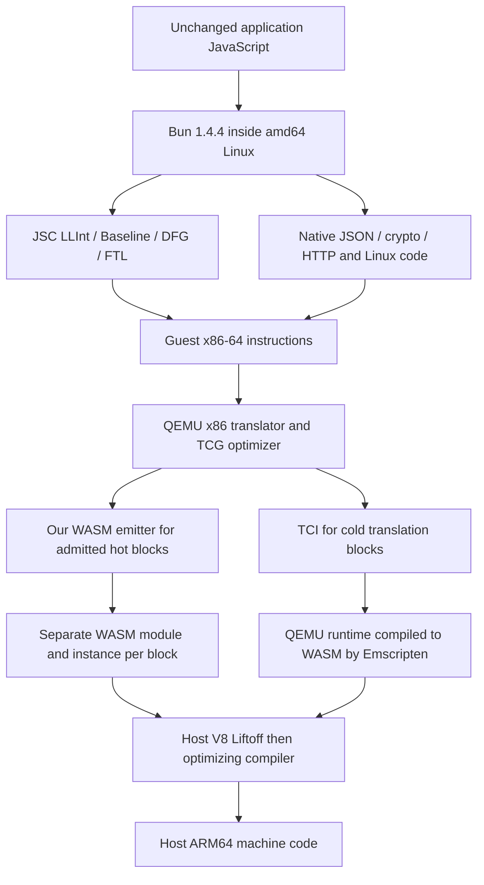

# Engine investigation, 2026-11-08

The latest four-block cold campaign found M3b ON slower than retained RNDS2:
integer 3.649x, JSON 1.198x, full launch/work horizon 1.183x. SHA/HTTP were
inconclusive. Those observations reject a performance promotion, and do not
identify the exclusive cost of fusion. See the accepted
[timing decision](../../docs/decisions/m3b-idle-timing-01.md).

## Exact reference sources

Actual clean checkouts are retained in `artifacts/engine-reference-01/source/`:

| Directory | Version / reason | Commit |
| --- | --- | --- |
| v8-chrome | Chrome 157.0.8103.38 reports V8 15.7.112.23 via Browser.getVersion | 440c1c463e2e528c309af5067952e7b11631507f |
| node | Node v26.11.1, including its patched V8 14.6.202.34-node.37 | 364593d0631def13e3043dd84f77ebca2c767ce5 |
| bun | Guest Bun 1.4.4 release source | 38afee6c84fcf48c0edb2466aa4b27d287a59c30 |
| webkit-bun | Bun's pinned WebKit/JSC, from scripts/build/deps/webkit.ts:6 | d6375c72affe0f70222cdcb45012b10f0bf3a9d5 |

Node and WebKit checkouts are sparse; their relevant engine directories are
present. These are source references matching version identities, not a claim
that our locally installed binaries have been reproduced from source. The
Bun release pin is stronger evidence than an unrelated upstream JSC revision.
`host-versions-01.json` retains actual Node versions and Chrome's CDP version.
No Debugger domain was enabled for that observation.

## Execution path

In Chrome the host engine is V8 15.7; running the outer VM in Node would use
Node's V8 14.6. Node currently orchestrates the Chrome benchmark; that alone
does **not** mean Node's V8 executes the measured VM. Guest Bun uses JSC,
not the host's V8. The application has no WebAssembly module: JSC's BBQ/OMG
WASM tiers do not compile the outer VM. A future guest WASM application would
add another guest compilation layer before x86 translation.

The integer workload is a JavaScript recurrence. JSON calls native host
functions in JSC (`runtime/JSONObject.cpp`), including SIMD string scanning.
SHA calls Bun's native crypto binding (`src/js/node/crypto.ts` Hash/update/
digest); HTTP also includes native runtime and guest kernel paths. Optimizing
only anonymous JSC-generated code cannot be assumed to improve all four.

## What the checked-out sources establish

1. **Two distinct hotness systems.** Our `tcg/wasm64.c` threshold is 1,500 TB
   entries. V8's default `wasm_tiering_budget` is 13,000,000 approximate executed
   bytes, not 13 million calls or our TB count. Liftoff decrements it at returns
   and loop backedges using generated-code costs, plus check/entry costs of
   20/40. Compilation is normally asynchronous. Admitting a TB does not prove
   its function has reached V8's optimizing tier during a timed interval.
   In both checked-out versions, the tier named `kTurbofan` routes WASM
   compilation through `ExecuteTurboshaftWasmCompilation`
   (`wasm/function-compiler.cc`); it is not JSC's optimizing pipeline.
2. **Cross-instance calls remain real boundaries.** Both versions'
   `wasm/module-compiler.cc`, `FeedbackMaker`, reject cross-instance
   call_ref/call_indirect inlining candidates and imported functions. Same
   instance inlining is enabled. Our dispatcher, generated TBs, native helper
   runtime and unwind adapter occupy different instances. A native WASM import
   remains WASM-to-WASM (`module-instantiate.cc`); it need not enter JavaScript.
3. **The existing baseline already avoids ordinary JS helper wrappers.**
   `scripts/helper-profile-runtime.js` returns the original function when no
   helper bus is configured. `scripts/native-unwind-runtime.js` captures the
   raw `asyncify_get_state` export before Emscripten export instrumentation and
   imports it into a tiny native predicate. The JS fallback exists, but is not
   a new optimization opportunity when native mode is active. Actual helper
   implementations can still call JS for genuinely asynchronous/host services.
4. **Long loops and tiering require care.** `MaybeOSR` in these V8 WASM
   Liftoff sources is a debugging path; Chrome's is additionally x64-only.
   It is not evidence of ordinary ARM64 Liftoff-to-optimized OSR. A long-lived
   WASM invocation may stay in its entering tier until return. Larger fused
   loops may delay use of compiled code; this is a hypothesis to measure, not
   an explanation already proved for M3b. Existing same-TB loops already stay
   in generated WASM.
5. **Memory64 is not a free array access.** Chrome enables memory64 trap
   handling on ARM64, but Liftoff's `BoundsCheckMem` still guards 64-bit indexes
   against the reserved-address limit, and explicit checks remain for other
   paths. Guest soft-MMU checks are separate and cannot be replaced by host
   bounds traps. Eliminating redundant private-state loads/stores can remove
   both memory operations and their associated checks without weakening guest
   access semantics.
6. **JSC hotness is not a fixed instruction count.** Bun enables JIT and
   concurrent compilation; ordinary file execution differs from its one-shot
   `-e` startup policy. JSC's thresholds are adjusted for code size, retries,
   startup deferral and compilation availability (`bytecode/CodeBlock.cpp`).
   DFG/FTL have guest OSR/deoptimization machinery. Guest compiler threads share
   the configured one emulated vCPU; V8's compilation jobs run on the host.
7. **JSC code publication invalidates naive permanent-PC assumptions.**
   LinkBuffer copies generated code through `performJITMemcpy`; permissions
   depend on platform/build flags. The source includes ordinary executable
   memory writes as well as protected paths. It does not justify assuming every
   publication has an mprotect syscall. Our observed code generations and
   alias-invalidation tests remain relevant; a virtual PC alone is not code
   identity. The exact JSC tier of the captured integer bytes remains unproved.
8. **SIMD lowering is concrete, not an assumption that V8 reconstructs x86.**
   Chrome's ARM64 Liftoff emitter maps `i8x16.swizzle` to `Tbl` and unsigned
   byte minimum to `Umin`. Its optimizing selector also selects `S128Tbl1` for
   swizzle. Byte bitmask uses a multi-instruction macro. Our PSHUFB emitter
   already supplies the required x86 control-byte mask before WASM swizzle;
   the new candidate removes argument traffic around it, not that semantic
   mask. RNDS2 currently emits scalar WASM rotates, Boolean operations and
   additions. V8 receives those operations, not an x86 SHA instruction or the
   original `createHash` call. Source-level expansion alone does not measure
   the remaining SHA cost or prove a host hardware-crypto substitution.
9. **Module construction is not total native compilation cost.** The sync
   `WebAssembly.Module` path consults V8's native module cache using wire bytes,
   enabled features and compile-time imports. Identical eligible modules can
   share compiled code. With default lazy compilation, a new function's first
   execution may compile Liftoff code, and optimizing work occurs later. Our
   `instantiate_wasm` constructor/instance timers therefore do not exhaustively
   attribute V8 compilation: first-entry work can fall inside execution time,
   and later background jobs have their own cost. Counting module constructors
   does not count unique native compilations. M1's exclusive attribution remains
   incomplete for this reason as well. No cache-hit or actual-tier proportion
   for the VM is asserted without an appropriate diagnostic observation.

The official [V8 pipeline overview](https://v8.dev/docs/wasm-compilation-pipeline)
and [JSC overview](https://docs.webkit.org/Deep%20Dive/JSC/JavaScriptCore.html)
help orient this investigation. Version-pinned source is the authority for the
specific claims above. Defaults are not proof of the tier of a particular
timed function. Debugger/profiler and nondefault tier flags belong in separate
diagnostic runs, never silently in the production timing protocol.

## Experiments selected from this evidence

First: apply early SIMD operand forwarding **on top of RNDS2**, without M3
guards or fusion. Current emitters already inline PSHUFB, min, equality and
mask; the generic helper allocator still stores arguments to memory, spills
call-clobbered locals and reloads those arguments. The candidate pins the
operands, preserves TCI's original stack ABI, and lets compiled SIMD consume
locals directly. RNDS2 and all generic helpers retain their existing path.
The prior setup screen used a different control and is not confirmation for
this combination. Fresh semantic fixtures and matched cold launches are
required. See `experiments/rnds2-setup` and its immutable source overlays.

Further candidates need separate evidence: optimize RNDS2 operand forwarding
with its exact R0/R1 clobber contract; census remaining scalar/vector helper
fallbacks; measure compilation/tiering separately; only then revisit regions
that remove enough materialization/calls to pay for guards and service. Do not
increase the instance cap, weaken memory/interrupt/SMC guards, disable JIT tiers,
or replace the workload to manufacture a speedup.

The immediate target is a lower measured time than retained RNDS2 with exact
results and bounded resources. A smaller emitted program is evidence of less
emission, not by itself evidence of that performance result.

The timing protocol additionally includes a fresh unchanged RNDS2 build with
the identical SDK and x86-only build command. The retained binary remains the
target, while this third arm separates source-change effects from rebuilding.
`experiments/engine-cost` contains a separate default-engine i32 call-boundary
probe for Node and Chrome. Its synthetic timings are not whole-VM estimates
and do not identify the tier of actual guest blocks.

The first complete screen is [recorded separately](setup-results-01.md): all
twelve fresh launches and the diagnostic passed, but no speedup was
demonstrated. The instance cap was not hit. Fewer argument stores did not
establish an end-to-end benefit. A follow-up isolated RNDS2 representation
experiment is in `experiments/rnds2-lanes/DESIGN.md`: scalar i32 lane locals,
conditional local declarations, unchanged generic call ABI and TCI fallback.
The actual extracted emitters pass 20,480 arbitrary-state checks each. Their
body sizes are 351 versus 267 bytes (216 versus 149 Wasm instructions). These
are emitted-code observations; they do not establish surviving native-code
size, execution tier, or performance.

The Chrome source classifies compilation hints under experimental features
(`src/flags/feature-flags.h:115`). They are not an assumed production control
for forcing selected TBs into the optimizing tier. Tier tracing is likewise
a developer diagnostic, and was not enabled in the primary captures. A smaller
body may also change the rate at which V8 spends its approximate-byte tiering
budget. Therefore an emitted-operation reduction needs measurement through
warmup and the complete workload, not only a steady-state arithmetic probe.

See the [actual-emitter/native-code follow-up](lane-codegen-results-01.md) for
the next correction: eight i32 loads added bounds/trap sites. The selected
v2 keeps four original-width loads and unpacks once. In the same forced-tier
Node/V8 component wrapper it reduced both baseline and optimizing native
instruction-code bytes. This is a reason to test the candidate, not a Chrome
VM speedup claim. Chrome disassembly remained unavailable in the attempted
diagnostic path; its failed assertions and cleanup evidence are preserved.

The scalar-lane v2 [screen](lane-v2-screen-results-01.md) and independent
[confirmation](lane-v2-confirm-results-01.md) are now complete. The confirmation
failed to establish a SHA gain against both references. No source/emission
argument overrides that timing result.

The next separate candidate uses the retained configure option
`--wasm64-32bit-address-limit` on unchanged RNDS2. In the checked-out Chrome
V8, `baseline/liftoff-compiler.cc:4240` emits an additional range check for
memory64 under trap handling. `wasm/turboshaft-graph-interface.cc:8252` also
handles the memory64 reservation bound separately. A memory32 profile can
remove that need, while introducing pointer truncations that may have costs.
No timing benefit is assumed. The pinned Emscripten mode compiles with i64 C
pointers and lowers memory operations to wasm32; it preserves the 64-bit guest.
See [design](../../experiments/memory32-rnds2/DESIGN.md).

The retained mode2 code sets a smaller default TB budget only when
`globalThis.Bun` identifies the *outer host*. Guest Bun inside the Chrome-hosted
VM does not select that branch. The Chrome experiment must preserve 12,000
charged instances, 2 GiB linear memory and the original guest/workload limits.
This profile is limited to 32-bit host linear-memory addresses, not a claim
about configurations above 4 GiB or about outer Bun/JSC performance.

The [memory-profile component diagnostic](memory32-codegen-results-01.md)
passed 40,960 semantic comparisons. It also demonstrates why emitted Wasm
operation counts are a poor speed proxy: the memory32 body has more Wasm
instructions but less native instruction code in both forced Node/V8 tiers.
The current Chrome source has cheaper memory64 checks than Node's bundled V8,
so those byte reductions are not Chrome performance predictions.

The full profile compiled and linked. Its packaging needed a strict, isolated
compatibility fix for Number-valued table indices; the first failed packaging
attempt remains retained. The corrected production package preserves the
compiled bytes and passed the production guest SIMD/setup/RNDS2 fixtures.
Its Wasm file is 4.53% larger than original, already failing the predeclared
1% file-growth promotion budget. Remaining diagnostics and timing are separate.

The [completed memory-profile study](memory32-results-01.md) did not improve its
predeclared horizon primary after eighteen fresh launches. It took 12.33% more
time than the matched rebuild (95% ratio interval 1.0483–1.2037), and grew the
Wasm file by 4.53%. All correctness/exposure checks passed, but it is not a
Chrome performance candidate. The matched rebuild itself showed an apparent
secondary 5.21% horizon reduction against the original imported binary. A
separate bounded twelve-launch confirmation is prepared under
`benchmarks/harness/rnds2-rebuild-confirm`; until it completes, this is a
selected exploratory signal, not a demonstrated new optimization.

The [independent rebuild confirmation](rebuild-confirm-results-01.md) is complete:
twelve fresh launches passed, but horizon ratio 1.0481 [0.9513,1.1548] did not
confirm the selected apparent gain. No above-RNDS2 gain is demonstrated by
these experiments. The next separate PLAN item is uninstrumented MSG1 timing.
The existing exact scalar emitter removes `gen_call`'s helper invocation,
`CHECK_UNWINDING_IDX` call and resume bookkeeping when selected. Its correctness
and positive guest exposure are documented, but counts do not establish its
time benefit. Off/on choices in the same runtime will control for binary layout.
